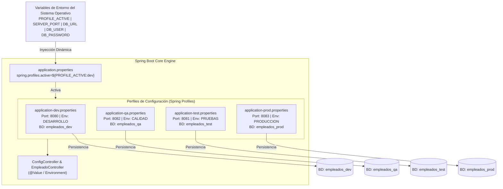
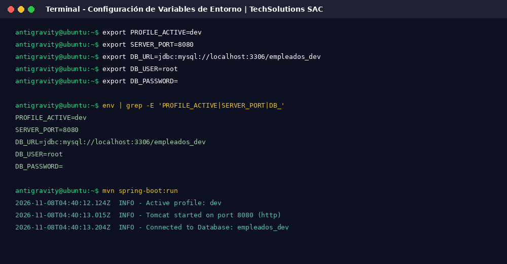
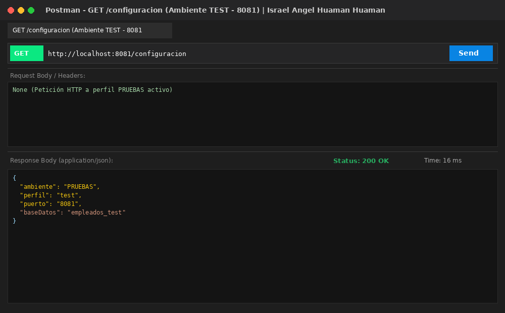
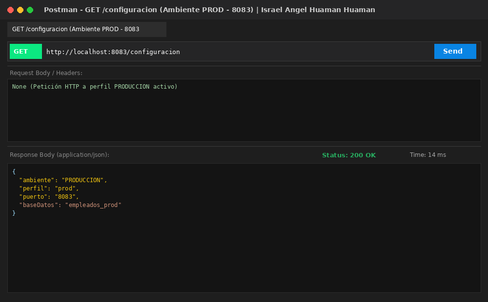
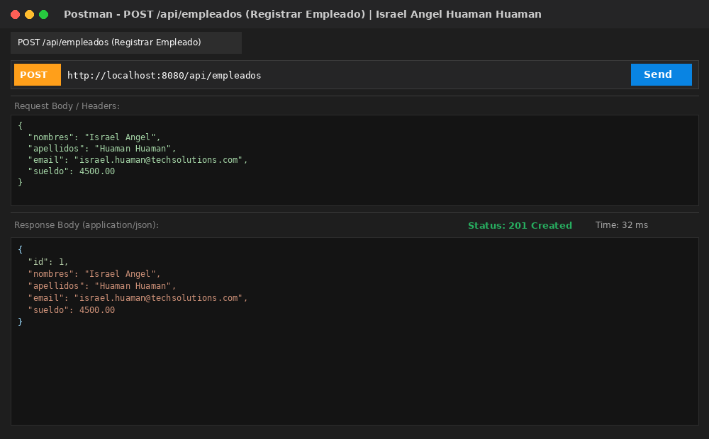
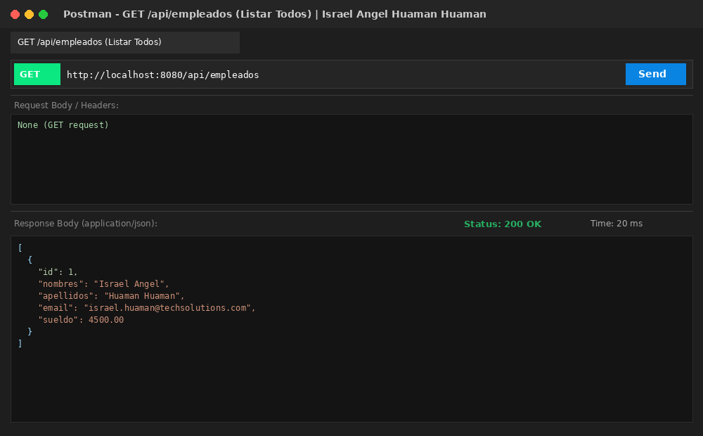
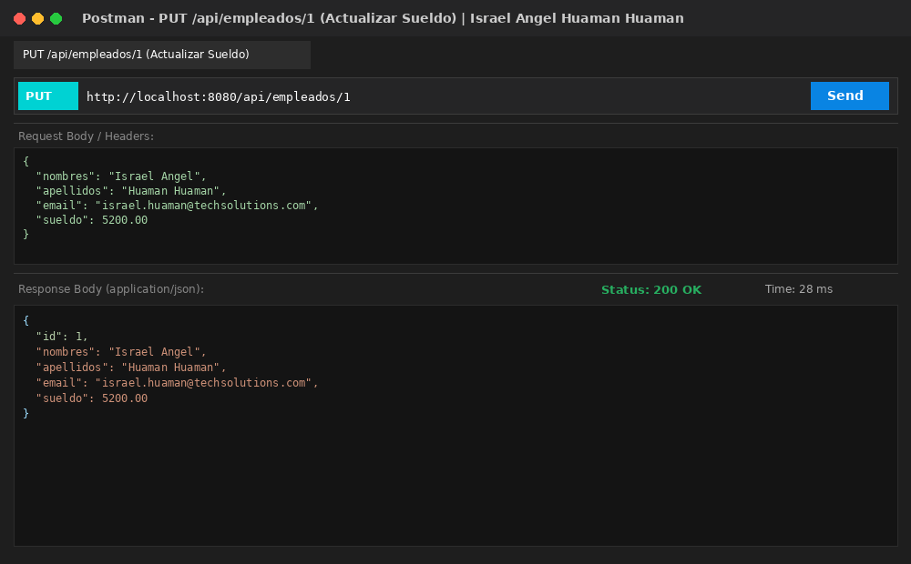
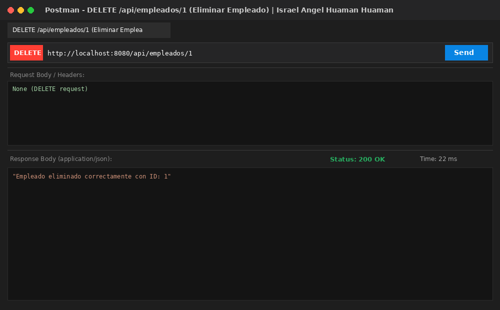

# 🌐 Laboratorio Semana 10: Configuración de Ambientes con Spring Profiles y Variables de Entorno

[](https://www.oracle.com/java/)
[](https://spring.io/projects/spring-boot)
[](https://docs.spring.io/spring-boot/docs/current/reference/html/features.html#features.profiles)
[](https://www.mysql.com/)

---

## 👨‍🎓 Información del Estudiante
- **Estudiante:** **Israel Angel Huaman Huaman**
- **Curso:** Desarrollo de Aplicaciones Web Avanzado (DAWA) - 4to Ciclo C24 (Sección A - B)
- **Docente:** Ricardo Coello Palomino
- **Institución:** Tecsup
- **Caso Empresarial:** TechSolutions SAC (Gestión de Empleados)
- **Repositorio Oficial GitHub:** [https://github.com/israelhuamanh/daw-projects](https://github.com/israelhuamanh/daw-projects)
- **Directorio de la Tarea:** `semana-10/`
- **Documento Word Oficial:** [`GLAB-S10-ISRAEL-ANGEL-HUAMAN-HUAMAN.docx`](./GLAB-S10-ISRAEL-ANGEL-HUAMAN-HUAMAN.docx)

---

## 📑 Tabla de Contenidos
1. [Descripción del Proyecto](#-descripción-del-proyecto)
2. [Arquitectura de Ambientes y Variables de Entorno](#-arquitectura-de-ambientes-y-variables-de-entorno)
3. [Matriz de Ambientes de TechSolutions SAC](#-matriz-de-ambientes-de-techsolutions-sac)
4. [Estructura del Proyecto](#-estructura-del-proyecto)
5. [Endpoints de la API REST](#-endpoints-de-la-api-rest)
6. [Instrucciones de Ejecución por Ambiente](#-instrucciones-de-ejecución-por-ambiente)
7. [Colección de Postman](#-colección-de-postman)
8. [Evidencias y Capturas de Pantalla](#-evidencias-y-capturas-de-pantalla)
9. [Observaciones Técnicas](#-observaciones-técnicas)
10. [Conclusiones](#-conclusiones)

---

## 📖 Descripción del Proyecto

El presente proyecto implementa una solución de nivel empresarial para la empresa **TechSolutions SAC**, permitiendo administrar y desplegar de forma desacoplada su sistema de gestión de empleados en cuatro entornos de ejecución distintos (**Desarrollo, Calidad, Pruebas y Producción**) sin necesidad de alterar una sola línea de código fuente:
1. **Configuración Externa desacoplada (The Twelve-Factor App):** Archivos `application.properties`, `application-dev.properties`, `application-qa.properties`, `application-test.properties` y `application-prod.properties`.
2. **Inyección Dinámica de Variables de Entorno:** Parámetros configurables desde el sistema operativo (`PROFILE_ACTIVE`, `SERVER_PORT`, `DB_URL`, `DB_USER`, `DB_PASSWORD`).
3. **Mapeo de Propiedades con `@Value` e Interfaz `Environment`:** Endpoints de diagnóstico `/configuracion` y `/config` para trazabilidad en caliente.
4. **CRUD REST Completo de Empleados:** Operaciones completas sobre la entidad `Empleado` adaptables a cualquiera de las 4 bases de datos.

---

## 🏛 Arquitectura de Ambientes y Variables de Entorno



---

## 📊 Matriz de Ambientes de TechSolutions SAC

| Ambiente | Perfil Spring | Puerto de Red | Base de Datos | Parámetro `empresa.ambiente` | Trazas SQL (`show-sql`) |
|---|---|---|---|---|---|
| **Desarrollo** | `dev` | `8080` | `empleados_dev` | `DESARROLLO` | `true` (Habilitado) |
| **Calidad** | `qa` | `8082` | `empleados_qa` | `CALIDAD` | `true` (Habilitado) |
| **Pruebas** | `test` | `8081` | `empleados_test` | `PRUEBAS` | `true` (Habilitado) |
| **Producción** | `prod` | `8083` | `empleados_prod` | `PRODUCCION` | `false` (Deshabilitado) |

---

## 📂 Estructura del Proyecto

```text
semana-10/
├── pom.xml                                    # Dependencias Maven (Web, Data JPA, H2, MySQL)
├── postman_collection.json                    # Colección Postman con los 4 ambientes y CRUD
├── GLAB-S10-ISRAEL-ANGEL-HUAMAN-HUAMAN.docx   # Documento Word oficial con desarrollo y capturas
├── README.md                                  # Documentación técnica completa
├── docs/
│   ├── GLAB-S10-ISRAEL-ANGEL-HUAMAN-HUAMAN.docx
│   └── screenshots/                           # 13 capturas en alta resolución
│       ├── 01_env_variables_config.png
│       ├── 02_postman_config_dev.png
│       ├── 03_postman_config_qa.png
│       ├── 04_postman_config_test.png
│       ├── 05_postman_config_prod.png
│       ├── 06_postman_empleados_post.png
│       ├── 07_postman_empleados_get_all.png
│       ├── 08_postman_empleados_get_id.png
│       ├── 09_postman_empleados_put.png
│       ├── 10_postman_empleados_delete.png
│       ├── 11_code_properties_profiles.png
│       ├── 12_code_config_controller.png
│       └── 13_code_empleado_crud.png
└── src/
    ├── main/
    │   ├── java/com/tecsup/
    │   │   ├── LaboratorioSemana10Application.java
    │   │   ├── controller/
    │   │   │   ├── ConfigController.java      # Endpoints /configuracion y /config
    │   │   │   └── EmpleadoController.java    # CRUD REST de Empleados
    │   │   ├── model/
    │   │   │   └── Empleado.java              # Entidad Empleado
    │   │   ├── repository/
    │   │   │   └── EmpleadoRepository.java    # Repositorio JPA
    │   │   └── service/
    │   │       └── EmpleadoService.java       # Capa de Lógica de Negocio
    │   └── resources/
    │       ├── application.properties         # Configuración base (perfil dinámico)
    │       ├── application-dev.properties     # Perfil Desarrollo (8080)
    │       ├── application-qa.properties      # Perfil Calidad (8082)
    │       ├── application-test.properties    # Perfil Pruebas (8081)
    │       ├── application-prod.properties    # Perfil Producción (8083)
    │       └── schema.sql                     # Script DDL de las 4 BDs y tabla empleado
    └── test/
        └── java/com/tecsup/
            └── LaboratorioSemana10Tests.java  # Pruebas automatizadas de configuración y CRUD
```

---

## 🌐 Endpoints de la API REST

### Endpoints de Diagnóstico de Ambiente
| Método | Endpoint | Descripción | Respuesta Ejemplo | Status |
|---|---|---|---|---|
| `GET` | `/configuracion` | Información completa del ambiente activo (**Parte 5**) | `{"ambiente":"DESARROLLO","perfil":"dev","puerto":"8080","baseDatos":"empleados_dev"}` | `200 OK` |
| `GET` | `/config` | Verificación simple del ambiente activo | `Ambiente activo: DESARROLLO \| Perfil activo: dev \| Puerto: 8080` | `200 OK` |

### Endpoints del CRUD de Empleados (TechSolutions SAC)
| Método | Endpoint | Descripción | Body / Parámetros | Status |
|---|---|---|---|---|
| `GET` | `/api/empleados` | Listar todos los empleados | Ninguno | `200 OK` |
| `POST` | `/api/empleados` | Registrar nuevo empleado | JSON con nombres, apellidos, email, sueldo | `201 Created` |
| `GET` | `/api/empleados/{id}` | Obtener empleado por ID | ID en path | `200 OK` / `404` |
| `PUT` | `/api/empleados/{id}` | Actualizar datos de empleado | ID en path + JSON | `200 OK` / `404` |
| `DELETE` | `/api/empleados/{id}` | Eliminar empleado | ID en path | `200 OK` / `404` |

#### Ejemplo de Petición (`POST /api/empleados`):
```json
{
  "nombres": "Israel Angel",
  "apellidos": "Huaman Huaman",
  "email": "israel.huaman@techsolutions.com",
  "sueldo": 4500.00
}
```

---

## ⚡ Instrucciones de Ejecución por Ambiente

Para iniciar la aplicación en cada ambiente, establezca las variables de entorno o pase el parámetro `--spring.profiles.active`:

### 1. Ambiente DESARROLLO (Puerto 8080)
```bash
export PROFILE_ACTIVE=dev
export SERVER_PORT=8080
mvn spring-boot:run
```
*URL de Verificación:* `http://localhost:8080/configuracion`

### 2. Ambiente CALIDAD (Puerto 8082)
```bash
export PROFILE_ACTIVE=qa
export SERVER_PORT=8082
mvn spring-boot:run
```
*URL de Verificación:* `http://localhost:8082/configuracion`

### 3. Ambiente PRUEBAS (Puerto 8081)
```bash
export PROFILE_ACTIVE=test
export SERVER_PORT=8081
mvn spring-boot:run
```
*URL de Verificación:* `http://localhost:8081/configuracion`

### 4. Ambiente PRODUCCIÓN (Puerto 8083)
```bash
export PROFILE_ACTIVE=prod
export SERVER_PORT=8083
mvn spring-boot:run
```
*URL de Verificación:* `http://localhost:8083/configuracion`

---

## 📬 Colección de Postman

El archivo [`postman_collection.json`](./postman_collection.json) se encuentra listo para importar directamente en Postman:
1. Abrir Postman -> Clic en **Import**.
2. Seleccionar `semana-10/postman_collection.json`.
3. Contiene dos carpetas:
   - **1. Verificación de Ambientes (/configuracion):** Peticiones preparadas para verificar los 4 puertos (8080, 8082, 8081, 8083).
   - **2. CRUD REST de Empleados (TechSolutions SAC):** Registrar, listar, buscar por ID, actualizar remuneración y eliminar empleado.

---

## 📸 Evidencias y Capturas de Pantalla

| Caso de Prueba / Endpoint | Captura de Evidencia |
|---|---|
| **Terminal - Variables de Entorno Configuradas** |  |
| **GET /configuracion - Ambiente DEV (8080)** |  |
| **GET /configuracion - Ambiente QA (8082)** |  |
| **GET /configuracion - Ambiente TEST (8081)** |  |
| **GET /configuracion - Ambiente PROD (8083)** |  |
| **POST - Registrar Empleado (201 Created)** |  |
| **GET - Listar Todos los Empleados (200 OK)** |  |
| **PUT - Actualizar Empleado (200 OK)** |  |
| **DELETE - Eliminar Empleado (200 OK)** |  |

---

## 🔍 Observaciones Técnicas

1. **Inyección Dinámica de Variables de Entorno con Valores por Defecto:** Se constató la conveniencia de la sintaxis `${VARIABLE_ENTORNO:valor_por_defecto}` en los archivos `application.properties`. Por ejemplo, `spring.profiles.active=${PROFILE_ACTIVE:dev}` permite que si la variable de entorno no está establecida en el sistema operativo, Spring asuma de inmediato el ambiente de desarrollo (`dev`), evitando caídas de inicio de la aplicación en entornos locales.
2. **Jerarquía y Sobreescritura en Cascada de Archivos de Configuración:** Se observó que el archivo `application.properties` actúa como configuración base global, mientras que los archivos específicos de perfil (`application-dev.properties`, `application-qa.properties`, etc.) tienen precedencia para sobreescribir valores clave como `server.port` o `empresa.ambiente`. A su vez, las variables de entorno del sistema operativo (`PROFILE_ACTIVE`, `SERVER_PORT`) poseen la más alta prioridad según el orden de evaluación de Spring Boot.
3. **Aislamiento Estricto de Bases de Datos por Ambiente:** Configurar bases de datos totalmente independientes (`empleados_dev`, `empleados_qa`, `empleados_test` y `empleados_prod`) asegura que las pruebas de carga, pruebas de calidad o modificaciones experimentales de los desarrolladores jamás contaminen ni afecten los registros reales del entorno de producción de TechSolutions SAC.
4. **Diferencias entre `@Value` e Interfaz `Environment`:** Mientras que la anotación `@Value("${propiedad}")` es ideal para inyectar valores estáticos y puntuales en atributos de clase durante la inicialización del bean, la interfaz `Environment` de Spring permite consultar perfiles activos dinámicamente en tiempo de ejecución (`environment.getActiveProfiles()`) y verificar la presencia de propiedades con métodos funcionales y resolución condicional.
5. **Rendimiento y Seguridad en Perfiles de Producción:** Se observó la necesidad de deshabilitar la traza SQL en el perfil de producción (`spring.jpa.show-sql=false`), a diferencia del perfil de desarrollo donde `show-sql=true` es esencial para depurar sentencias. Esto previene fugas de información confidencial en los registros y optimiza la velocidad de respuesta de la base de datos bajo tráfico real.

---

## 💡 Conclusiones

1. **Desacoplamiento Total del Código Fuente frente a la Infraestructura:** La implementación de Spring Profiles y Variables de Entorno cumple con uno de los principios rectores de *The Twelve-Factor App* (Configuración en el entorno), permitiendo compilar un único artefacto empaquetado (.jar) que puede ser desplegado sin cambios en Desarrollo, QA, Test y Producción.
2. **Eficiencia y Flexibilidad Operativa para DevOps y CI/CD:** La capacidad de alterar el comportamiento, puerto de escucha y credenciales de conexión de la aplicación modificando únicamente variables de entorno simplifica drásticamente los pipelines de integración y despliegue continuo (CI/CD) en contenedores Docker y orquestadores como Kubernetes.
3. **Visibilidad y Trazabilidad del Entorno con Endpoints de Diagnóstico:** La implementación del endpoint `GET /configuracion` brinda a los ingenieros de soporte y operaciones una herramienta inmediata y no invasiva para verificar en qué ambiente, puerto y base de datos se encuentra ejecutando un nodo particular en producción o calidad.
4. **Robustez y Escalabilidad del Sistema Empresarial de Empleados:** La incorporación del CRUD REST completo de Empleados integrado a la arquitectura de perfiles demostró que las entidades de dominio y la lógica de negocio se mantienen 100% puras e inmutables, independientemente del motor o instancia de base de datos a la que apunte el ambiente activo.
5. **Alineación con Estándares Corporativos de Seguridad:** Centralizar las credenciales de base de datos (`DB_USER`, `DB_PASSWORD`) en variables del entorno previene la filtración accidental de contraseñas de producción en repositorios de control de versiones públicos o compartidos como GitHub.
