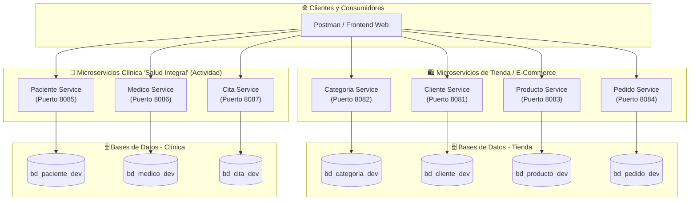
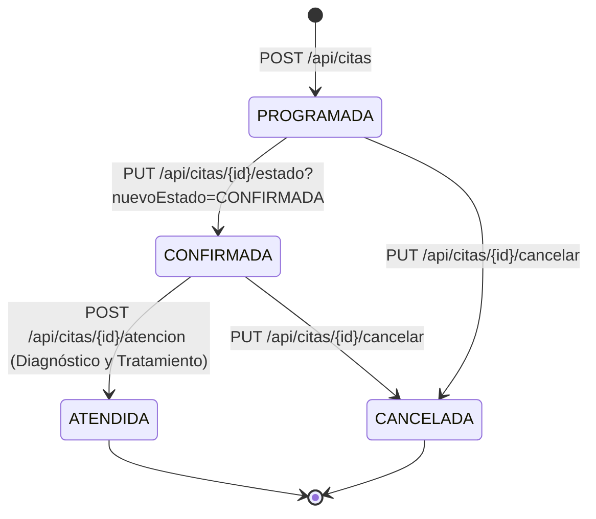

# 🏥 Arquitectura de Microservicios con Spring Boot y YAML - Semana 11

**Estudiante:** Israel Angel Huaman Huaman  
**Institución:** Tecsup  
**Docente:** Ricardo Coello Palomino  
**Curso:** Desarrollo de Aplicaciones Web Avanzado (DAWA)  
**Repositorio Oficial:** [https://github.com/israelhuamanh/daw-projects](https://github.com/israelhuamanh/daw-projects)  
**Documento Oficial Word:** [`GLAB-S11-ISRAEL-ANGEL-HUAMAN-HUAMAN.docx`](./GLAB-S11-ISRAEL-ANGEL-HUAMAN-HUAMAN.docx)

---

## 📋 Descripción del Proyecto

Este proyecto comprende la implementación de una **Arquitectura de Microservicios Distribuida** con **Spring Boot 3**, utilizando el patrón **Database per Service**, configuración declarativa en formato **YAML** y gestión de ambientes desacoplados (**dev** y **prod**).

El laboratorio se divide en dos componentes principales:
1. **Procedimiento - Microservicios de Comercio Electrónico (Tienda):**
   - `categoria-service` (Puerto 8082 dev / 9092 prod)
   - `cliente-service` (Puerto 8081 dev / 9081 prod)
   - `producto-service` (Puerto 8083 dev / 9083 prod)
   - `pedido-service` (Puerto 8084 dev / 9084 prod)
2. **Actividad - Sistema de Gestión de Citas Médicas para la Clínica "Salud Integral":**
   - `paciente-service` (Puerto 8085 dev / 9085 prod)
   - `medico-service` (Puerto 8086 dev / 9086 prod)
   - `cita-service` (Puerto 8087 dev / 9087 prod)

---

## 🏛️ Diagrama de Arquitectura de Microservicios



---

## ⚙️ Matriz de Servicios, Puertos y Bases de Datos

| Microservicio | Módulo | Puerto Dev | Puerto Prod | Base de Datos Dev | Base de Datos Prod | Context Path |
|---|---|:---:|:---:|---|---|---|
| **`categoria-service`** | Tienda | `8082` | `9092` | `bd_categoria_dev` | `bd_categoria` | `/api/categorias` |
| **`cliente-service`** | Tienda | `8081` | `9081` | `bd_cliente_dev` | `bd_cliente` | `/api/clientes` |
| **`producto-service`** | Tienda | `8083` | `9083` | `bd_producto_dev` | `bd_producto` | `/api/productos` |
| **`pedido-service`** | Tienda | `8084` | `9084` | `bd_pedido_dev` | `bd_pedido` | `/api/pedidos` |
| **`paciente-service`** | Clínica | `8085` | `9085` | `bd_paciente_dev` | `bd_paciente` | `/api/pacientes` |
| **`medico-service`** | Clínica | `8086` | `9086` | `bd_medico_dev` | `bd_medico` | `/api/medicos` \| `/api/especialidades` |
| **`cita-service`** | Clínica | `8087` | `9087` | `bd_cita_dev` | `bd_cita` | `/api/citas` |

---

## 🔄 Máquina de Estados para Citas Médicas (`cita-service`)



> **Reglas de Negocio Implementadas:**
> - Una cita no puede ser cancelada ni modificada si ya se encuentra en estado `ATENDIDA`.
> - Al registrar una atención médica mediante `POST /api/citas/{id}/atencion`, el estado de la cita pasa automáticamente a `ATENDIDA`.
> - Las cancelaciones son finales; una cita cancelada no permite registrar atención clínica.

---

## 🚀 Endpoints RESTful Implementados

### 1. Categoria Service (`http://localhost:8082`)
- `GET /api/categorias`: Listar todas las categorías.
- `POST /api/categorias`: Registrar categoría (`CategoriaDTO`).
- `GET /api/categorias/{id}`: Obtener categoría por ID.
- `PUT /api/categorias/{id}`: Actualizar categoría.
- `DELETE /api/categorias/{id}`: Eliminar categoría.

### 2. Cliente Service (`http://localhost:8081`)
- `GET /api/clientes`: Listar clientes registrados.
- `POST /api/clientes`: Registrar cliente con validación de DNI (8 dígitos).
- `GET /api/clientes/{id}`: Buscar cliente por ID.
- `PUT /api/clientes/{id}`: Modificar información de cliente.
- `DELETE /api/clientes/{id}`: Dar de baja a un cliente.

### 3. Producto Service (`http://localhost:8083`)
- `GET /api/productos`: Catálogo general de productos.
- `POST /api/productos`: Registrar producto con stock y precio positivo.
- `GET /api/productos/{id}`: Obtener producto por ID.
- `GET /api/productos/categoria/{categoriaId}`: Listar productos por categoría.
- `PUT /api/productos/{id}`: Actualizar stock o precio.
- `DELETE /api/productos/{id}`: Eliminar producto.

### 4. Pedido Service (`http://localhost:8084`)
- `GET /api/pedidos`: Listar pedidos con sus detalles (`DetallePedido`).
- `POST /api/pedidos`: Crear pedido con cascada completa (`CascadeType.ALL`).
- `GET /api/pedidos/{id}`: Obtener detalle íntegro de un pedido.
- `DELETE /api/pedidos/{id}`: Anular pedido.

### 5. Paciente Service (`http://localhost:8085`)
- `GET /api/pacientes`: Listar pacientes de la clínica.
- `POST /api/pacientes`: Registrar nuevo paciente.
- `GET /api/pacientes/{id}`: Consultar ficha de paciente por ID.
- `PUT /api/pacientes/{id}`: Actualizar datos de paciente.
- `DELETE /api/pacientes/{id}`: Eliminar paciente.

### 6. Medico Service (`http://localhost:8086`)
- `GET /api/especialidades`: Listar especialidades médicas.
- `POST /api/especialidades`: Crear especialidad (ej. Cardiología, Pediatría).
- `GET /api/medicos`: Listar médicos con su especialidad y horarios.
- `POST /api/medicos`: Registrar médico colegiado (CMP).
- `POST /api/medicos/{id}/horarios`: Asignar horario de atención por día de la semana.
- `GET /api/medicos/{id}/horarios`: Consultar horarios disponibles del médico.

### 7. Cita Service (`http://localhost:8087`)
- `GET /api/citas`: Listar citas programadas.
- `POST /api/citas`: Programar cita médica (estado inicial `PROGRAMADA`).
- `GET /api/citas/{id}`: Consultar cita por ID.
- `PUT /api/citas/{id}/estado?nuevoEstado=CONFIRMADA`: Transición de estado.
- `PUT /api/citas/{id}/cancelar`: Cancelación formal de cita.
- `POST /api/citas/{id}/atencion`: Registro de atención médica (diagnóstico, tratamiento, observaciones) y transición automática a `ATENDIDA`.
- `GET /api/citas/{id}/atencion`: Consultar la atención médica registrada.

---

## 🗃️ Base de Datos y DDL

El script consolidado con todos los esquemas y datos iniciales se encuentra en:
[`database-scripts.sql`](./database-scripts.sql)

Para ejecutarlo en MySQL:
```bash
mysql -u root -p < database-scripts.sql
```

---

## 📮 Colección de Postman

La colección completa con todos los requests, payloads de prueba de la guía y validaciones se encuentra en:
[`postman_collection.json`](./postman_collection.json)

---

## 📸 Evidencias y Capturas de Pantalla

Todas las capturas de código y ejecución en Postman se encuentran organizadas en [`docs/screenshots/`](./docs/screenshots/):
- `01_tienda_categoria_post.png`
- `02_tienda_categoria_get_all.png`
- `03_tienda_cliente_post.png`
- `04_tienda_cliente_get.png`
- `05_tienda_producto_post.png`
- `06_tienda_producto_categoria.png`
- `07_tienda_pedido_post.png`
- `08_tienda_yaml_profiles.png`
- `09_clinica_paciente_post.png`
- `10_clinica_medico_post.png`
- `11_clinica_cita_post.png`
- `12_clinica_cita_estado_confirmada.png`
- `13_clinica_atencion_post.png`
- `14_clinica_cancelar_cita.png`
- `15_code_microservicios_architecture.png`

---

## 📝 Documento Oficial Word

El informe formal completado con la carátula, datos del estudiante, respuestas, capturas y 5 observaciones y 5 conclusiones se encuentra disponible en:
- [`GLAB-S11-ISRAEL-ANGEL-HUAMAN-HUAMAN.docx`](./GLAB-S11-ISRAEL-ANGEL-HUAMAN-HUAMAN.docx)
- [`docs/GLAB-S11-ISRAEL-ANGEL-HUAMAN-HUAMAN.docx`](./docs/GLAB-S11-ISRAEL-ANGEL-HUAMAN-HUAMAN.docx)
