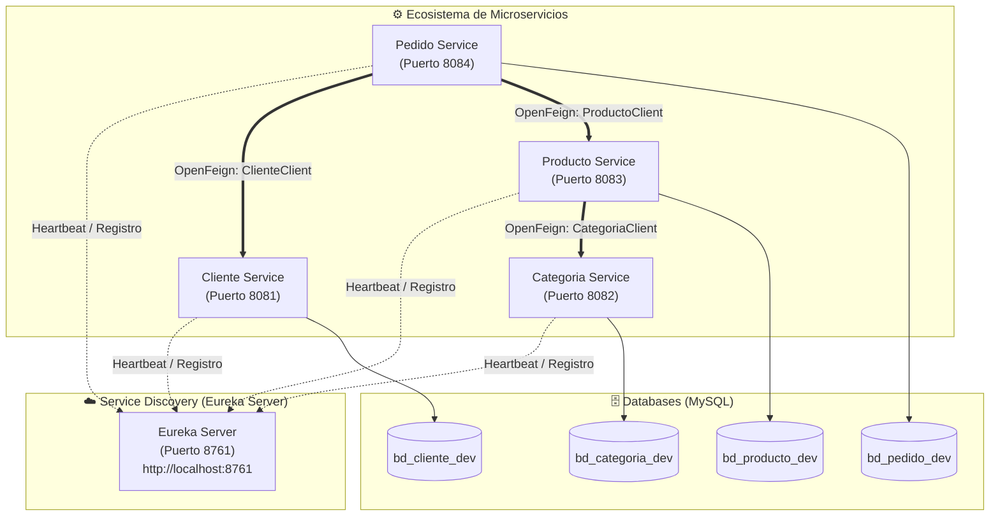

# 🌐 Comunicación entre Microservicios con OpenFeign y Eureka Server - Semana 12

**Estudiante:** Israel Angel Huaman Huaman  
**Institución:** Tecsup  
**Docente:** Ricardo Coello Palomino  
**Curso:** Desarrollo de Aplicaciones Web Avanzado (DAWA)  
**Repositorio Oficial:** [https://github.com/israelhuamanh/daw-projects](https://github.com/israelhuamanh/daw-projects)  
**Documento Oficial Word:** [`GLAB-S12-ISRAEL-ANGEL-HUAMAN-HUAMAN.docx`](./GLAB-S12-ISRAEL-ANGEL-HUAMAN-HUAMAN.docx)

---

## 📋 Descripción del Laboratorio

El laboratorio de la **Semana 12** se enfoca en la implementación de **comunicación sincrónica declarativa entre microservicios** utilizando el ecosistema de **Spring Cloud**:
- **Netflix Eureka Server:** Registro centralizado y descubrimiento dinámico de instancias (Service Registry).
- **Spring Cloud OpenFeign:** Clientes HTTP declarativos basados en interfaces para el consumo de APIs REST entre microservicios sin acoplamiento a direcciones IP ni puertos físicos.
- **Database per Service:** Persistencia independiente en MySQL para cada dominio de negocio.

El proyecto se estructuró trabajando directamente sobre la carpeta base **`microservicios`** proporcionada por el docente, extendiéndola con la **Actividad** para conformar el ecosistema completo:

1. **`eureka-server`** (Puerto `8761`): Servidor de Registro y Descubrimiento.
2. **`categoria-service`** (Puerto `8082`): Microservicio de gestión de categorías.
3. **`producto-service`** (Puerto `8083`): Catálogo de productos; consulta y completa datos de categoría invocando a `categoria-service` mediante `CategoriaClient` (OpenFeign).
4. **`cliente-service`** (Puerto `8081` - Actividad): Administración de clientes con validación estricta de DNI de 8 dígitos y datos de contacto.
5. **`pedido-service`** (Puerto `8084` - Actividad): Registro de pedidos (sin duplicar datos de clientes ni productos) y composición de respuesta unificada mediante `ClienteClient` y `ProductoClient` (OpenFeign).

---

## 🏛️ Diagrama de Arquitectura de Comunicación



---

## ⚙️ Matriz de Servicios, Puertos y Bases de Datos

| Microservicio | Puerto | Nombre en Eureka | Base de Datos (Dev) | Clientes Feign Integrados |
|---|:---:|---|---|---|
| **`eureka-server`** | `8761` | `eureka-server` | *(En memoria)* | N/A (Servidor de Registro) |
| **`categoria-service`** | `8082` | `categoria-service` | `bd_categoria_dev` | N/A (Provee `/api/categorias/{id}`) |
| **`producto-service`** | `8083` | `producto-service` | `bd_producto_dev` | `CategoriaClient` ➔ `categoria-service` |
| **`cliente-service`** | `8081` | `cliente-service` | `bd_cliente_dev` | N/A (Provee `/api/clientes/{id}`) |
| **`pedido-service`** | `8084` | `pedido-service` | `bd_pedido_dev` | `ClienteClient` ➔ `cliente-service`<br>`ProductoClient` ➔ `producto-service` |

---

## 🔄 Flujo de Agregación de Datos en `pedido-service`

Al ejecutar una consulta de pedido `GET /api/pedidos/{id}`:
1. `pedido-service` recupera el registro de la tabla `pedido` (`id`, `clienteId`, `productoId`, `cantidad`, `fecha`, `total`, `estado`).
2. Invoca de manera concurrente o secuencial:
   - `ClienteClient.obtenerCliente(pedido.getClienteId())` hacia `cliente-service`.
   - `ProductoClient.obtenerProducto(pedido.getProductoId())` hacia `producto-service`.
3. Completa los atributos `@Transient private ClienteDTO cliente` y `@Transient private ProductoDTO producto`.
4. Retorna el payload JSON final enriquecido:

```json
{
  "id": 1,
  "cantidad": 2,
  "fecha": "2026-06-12",
  "estado": "PENDIENTE",
  "total": 5000.0,
  "cliente": {
    "id": 1,
    "nombre": "Carlos",
    "apellido": "Ramirez",
    "nroDni": "12345678",
    "telefono": "987654321"
  },
  "producto": {
    "id": 1,
    "nombre": "Laptop",
    "precio": 2500.0,
    "stock": 10
  }
}
```

---

## 🚀 Endpoints RESTful Implementados

### 1. Eureka Server (`http://localhost:8761`)
- `GET /`: Dashboard web visual de Eureka.
- `GET /eureka/apps`: Registro JSON de aplicaciones activas.

### 2. Categoria Service (`http://localhost:8082`)
- `GET /api/categorias`: Listar todas las categorías.
- `POST /api/categorias`: Registrar categoría (`CategoriaDTO`).
- `GET /api/categorias/{id}`: Consultar categoría por ID.
- `PUT /api/categorias/{id}`: Actualizar categoría.
- `DELETE /api/categorias/{id}`: Eliminar categoría.

### 3. Producto Service (`http://localhost:8083`)
- `GET /api/productos`: Listar productos con categoría completada vía OpenFeign.
- `POST /api/productos`: Crear producto validado.
- `GET /api/productos/{id}`: Obtener producto por ID enriquecido con su categoría.
- `PUT /api/productos/{id}`: Actualizar producto.
- `DELETE /api/productos/{id}`: Eliminar producto.

### 4. Cliente Service - Actividad (`http://localhost:8081`)
- `GET /api/clientes`: Listar todos los clientes.
- `POST /api/clientes`: Registrar cliente con validación estricta de DNI de 8 dígitos (`@Size(min=8, max=8)`).
- `GET /api/clientes/{id}`: Buscar cliente por ID.
- `PUT /api/clientes/{id}`: Modificar cliente existente.
- `DELETE /api/clientes/{id}`: Dar de baja a un cliente.

### 5. Pedido Service - Actividad (`http://localhost:8084`)
- `POST /api/pedidos`: Registrar pedido validando existencia de producto y cliente en sus respectivos microservicios, calculando el importe total y asignando estado inicial `PENDIENTE`.
- `GET /api/pedidos/{id}`: Consultar pedido por ID con datos integrados de Cliente y Producto obtenidos vía OpenFeign.
- `GET /api/pedidos`: Listar todos los pedidos con sus datos enriquecidos.
- `PUT /api/pedidos/{id}/estado?nuevoEstado=ATENDIDO`: Actualizar estado a `ATENDIDO` o `PENDIENTE`.
- `PUT /api/pedidos/{id}/anular` / `DELETE /api/pedidos/{id}`: Anulación lógica del pedido sin borrado físico de la base de datos.

---

## 🗃️ Base de Datos y Scripts DDL

El script DDL consolidado para la creación de las 4 bases de datos y registros semilla se encuentra en:
[`database-scripts.sql`](./database-scripts.sql)

Para ejecutarlo en MySQL:
```bash
mysql -u root -p < database-scripts.sql
```

---

## 📮 Colección de Postman

La colección completa con todas las carpetas, peticiones y payloads organizados por microservicio se encuentra en:
[`postman_collection.json`](./postman_collection.json)

---

## 📸 Evidencias Gráficas

Las capturas de pantalla de la ejecución y el código se encuentran en [`docs/screenshots/`](./docs/screenshots/):
- `01_eureka_server_dashboard.png`: Panel de Eureka Server con las 4 instancias registradas (`UP`).
- `02_postman_categoria_post.png`: POST `/api/categorias` (201 Created).
- `03_postman_categoria_get.png`: GET `/api/categorias` (200 OK).
- `04_postman_producto_post.png`: POST `/api/productos` (201 Created).
- `05_postman_producto_feign_get.png`: GET `/api/productos` con categoría obtenida vía OpenFeign (200 OK).
- `06_postman_cliente_post.png`: POST `/api/clientes` con validación de DNI (201 Created).
- `07_postman_cliente_get_id.png`: GET `/api/clientes/1` (200 OK).
- `08_postman_pedido_post.png`: POST `/api/pedidos` con validación y cálculo de total (201 Created).
- `09_postman_pedido_feign_get_id.png`: GET `/api/pedidos/1` con datos completos de pedido, cliente y producto (200 OK).
- `10_postman_pedido_estado_atendido.png`: PUT `/api/pedidos/1/estado?nuevoEstado=ATENDIDO` (200 OK).
- `11_postman_pedido_anular.png`: PUT `/api/pedidos/1/anular` (200 OK - anulación lógica).
- `12_code_eureka_config.png`: Código de configuración de Eureka Server.
- `13_code_feign_categoria_client.png`: Código de `CategoriaClient` en `producto-service`.
- `14_code_feign_pedido_clients.png`: Código de `ClienteClient` y `ProductoClient` en `pedido-service`.
- `15_code_pedido_service_feign_integration.png`: Código de integración y enriquecimiento en `PedidoService.java`.

---

## 📝 Documento Oficial Word

El informe académico final conforme al formato solicitado se encuentra en:
- [`GLAB-S12-ISRAEL-ANGEL-HUAMAN-HUAMAN.docx`](./GLAB-S12-ISRAEL-ANGEL-HUAMAN-HUAMAN.docx)
- [`docs/GLAB-S12-ISRAEL-ANGEL-HUAMAN-HUAMAN.docx`](./docs/GLAB-S12-ISRAEL-ANGEL-HUAMAN-HUAMAN.docx)
