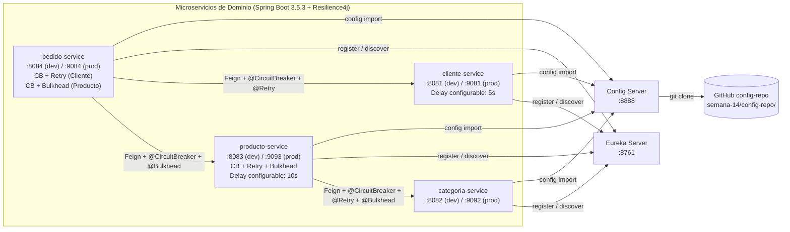

# 🛡️ Semana 14 — Config Server y Patrones de Resiliencia (Resilience4j)

**Curso:** Desarrollo de Aplicaciones Web Avanzado (DAWA) — 4 - C24  
**Institución:** Tecsup  
**Docente:** Ricardo Coello Palomino  
**Estudiante:** Israel Angel Huaman Huaman  
**Repositorio:** [https://github.com/israelhuamanh/daw-projects](https://github.com/israelhuamanh/daw-projects)

---

## 🎯 Objetivos del Laboratorio

1. **Configuración Centralizada con Spring Cloud Config Server (`8888`):** Centralizar la configuración de los 4 microservicios de dominio (`categoria-service`, `producto-service`, `cliente-service`, `pedido-service`) en un repositorio Git (`semana-14/config-repo/`) con perfiles `default`, `dev` y `prod`.
2. **Patrón Circuit Breaker (`@CircuitBreaker`):** Proteger las llamadas síncronas OpenFeign entre microservicios mediante **Resilience4j**, implementando métodos `fallback` que evitan fallos en cascada cuando un servicio dependiente se detiene:
   - Procedimiento: `producto-service` → `categoria-service` (`CategoriaCircuitService`).
   - Actividad: `pedido-service` → `cliente-service` (`ClienteCircuitService`) y `pedido-service` → `producto-service` (`ProductoCircuitService`).
3. **Patrón Retry (`@Retry`):** Reintentar automáticamente llamadas ante fallos transitorios o latencias temporales (`categoriaRetry` en `producto-service` y `clienteRetry` en `pedido-service` con demora simulada de 5 segundos en `cliente-service`).
4. **Patrón Bulkhead (`@Bulkhead`):** Aislar y limitar el número máximo de llamadas concurrentes (`maxConcurrentCalls: 2`) para evitar el agotamiento de hilos ante servicios lentos (`categoriaBulkhead` en `producto-service` y `productoBulkhead` en `pedido-service` con demora simulada de 10 segundos en `producto-service`).
5. **Verificación Real en Ejecución:** Compilar, levantar y probar todos los microservicios en vivo, obteniendo capturas reales de Config Server, Eureka Dashboard, respuestas HTTP, Actuator y consola JVM.

---

## 🏗️ Arquitectura del Sistema



---

## 📊 Matriz de Servicios, Puertos y Perfiles

| Microservicio | Puerto `dev` | Puerto `prod` | Base de Datos (`dev`) | Config Repo (`semana-14/config-repo/`) | Patrones Resilience4j |
|---|---:|---:|---|---|---|
| `config-server` | `8888` | `8888` | N/A | Fuente Git (`main`) | `@EnableConfigServer` |
| `eureka-server` | `8761` | `8761` | N/A | N/A | `@EnableEurekaServer` |
| `categoria-service` | `8082` | `9092` | `bd_categoria_dev` | `categoria-service{.yml,-dev.yml,-prod.yml}` | Delay simulado configurable |
| `producto-service` | `8083` | `9093` | `bd_producto_dev` | `producto-service{.yml,-dev.yml,-prod.yml}` | `categoriaService` (CB), `categoriaRetry`, `categoriaBulkhead` + Delay 10s |
| `cliente-service` | `8081` | `9081` | `bd_cliente_dev` | `cliente-service{.yml,-dev.yml,-prod.yml}` | Delay simulado 5s (`cliente.delay.ms`) |
| `pedido-service` | `8084` | `9084` | `bd_pedido_dev` | `pedido-service{.yml,-dev.yml,-prod.yml}` | `clienteService` (CB), `clienteRetry`, `productoService` (CB), `productoBulkhead` |

---

## 📁 Estructura de la Carpeta `semana-14`

```text
semana-14/
├── GLAB-S14-ISRAEL-ANGEL-HUAMAN-HUAMAN.docx   # Informe oficial completo del laboratorio
├── README.md                                   # Documentación técnica
├── database-scripts.sql                        # Scripts MySQL (bd_categoria_dev, bd_producto_dev, bd_cliente_dev, bd_pedido_dev)
├── postman_collection.json                     # Colección de pruebas Postman
├── config-repo/                                # Repositorio centralizado (12 archivos YAML: default, dev, prod)
│   ├── categoria-service.yml / -dev.yml / -prod.yml
│   ├── producto-service.yml  / -dev.yml / -prod.yml
│   ├── cliente-service.yml   / -dev.yml / -prod.yml
│   └── pedido-service.yml    / -dev.yml / -prod.yml
├── docs/
│   ├── GLAB-S14-ISRAEL-ANGEL-HUAMAN-HUAMAN.docx
│   └── screenshots/                            # 14 capturas reales obtenidas de los servicios en ejecución
└── microservicios/
    ├── config-server/                          # Spring Cloud Config Server (:8888)
    ├── eureka-server/                          # Netflix Eureka Server (:8761)
    ├── categoria-service/                      # Microservicio de Categorías (:8082)
    ├── producto-service/                       # Microservicio de Productos (:8083) + Resilience4j
    ├── cliente-service/                        # Microservicio de Clientes (:8081)
    ├── pedido-service/                         # Microservicio de Pedidos (:8084) + Resilience4j
    └── gateway-service/                        # API Gateway heredado (:8080)
```

---

## ⚖️ Análisis Técnico: Retry vs Bulkhead

| Criterio | Retry Pattern (`@Retry`) | Bulkhead Pattern (`@Bulkhead`) |
|---|---|---|
| **Objetivo principal** | Recuperarse de **fallos transitorios** (microcortes de red, timeouts momentáneos, reinicio breve de un pod). | **Aislar recursos y limitar concurrencia** (`maxConcurrentCalls`) para que un servicio lento no agote los hilos del consumidor. |
| **Mecanismo** | Repite la invocación hasta `maxAttempts` esperando `waitDuration` entre intentos. | Controla el acceso con un semáforo o pool de hilos; si se excede el límite y `maxWaitDuration`, dispara el `fallback` inmediatamente. |
| **Impacto en latencia** | Aumenta el tiempo de respuesta cuando hay fallos, porque espera y reintenta antes de ejecutar el fallback. | Reduce la latencia de rechazo para el exceso de tráfico (fail-fast tras `maxWaitDuration`). |
| **Riesgo si se usa mal** | Puede provocar tormentas de reintentos (*retry storms*) sobre un servicio ya saturado o duplicar operaciones no idempotentes. | Si el límite es demasiado bajo, puede rechazar tráfico legítimo en picos de carga. |
| **Cuándo conviene usarlo** | Consultas de lectura idempotentes (`GET /api/clientes/{id}`) o integraciones con microcortes intermitentes. | Llamadas a servicios externos lentos o pesados (`GET /api/productos/{id}` con 10s de demora) para proteger el resto del sistema. |

---

## 📸 Evidencias Reales Capturadas en Ejecución

Todas las capturas fueron generadas ejecutando los 6 microservicios reales (`java -jar`) y consultándolos en vivo:

1. [`01_config_server_categoria_default.png`](./docs/screenshots/01_config_server_categoria_default.png) — Config Server: `GET /categoria-service/default`
2. [`02_config_server_producto_dev.png`](./docs/screenshots/02_config_server_producto_dev.png) — Config Server: `GET /producto-service/dev`
3. [`03_config_server_cliente_dev.png`](./docs/screenshots/03_config_server_cliente_dev.png) — Config Server (Actividad): `GET /cliente-service/dev`
4. [`04_config_server_pedido_dev.png`](./docs/screenshots/04_config_server_pedido_dev.png) — Config Server (Actividad): `GET /pedido-service/dev`
5. [`05_eureka_dashboard_real.png`](./docs/screenshots/05_eureka_dashboard_real.png) — Eureka Dashboard real (`http://localhost:8761`) con los 4 servicios UP
6. [`06_productos_antes_falla_real.png`](./docs/screenshots/06_productos_antes_falla_real.png) — `GET /api/productos` antes de detener `categoria-service`
7. [`07_productos_despues_falla_cb_real.png`](./docs/screenshots/07_productos_despues_falla_cb_real.png) — `GET /api/productos` tras detener `categoria-service` (Fallback activado)
8. [`08_productos_actuator_cb_real.png`](./docs/screenshots/08_productos_actuator_cb_real.png) — Actuator `GET /actuator/circuitbreakers` mostrando estado `OPEN`
9. [`09_consola_producto_retry_cb_real.png`](./docs/screenshots/09_consola_producto_retry_cb_real.png) — Consola real de `producto-service` con reintentos y fallback
10. [`10_pedidos_antes_falla_real.png`](./docs/screenshots/10_pedidos_antes_falla_real.png) — Actividad CB: `GET /api/pedidos` con todos los servicios activos
11. [`11_pedidos_falla_cliente_cb_real.png`](./docs/screenshots/11_pedidos_falla_cliente_cb_real.png) — Actividad CB: `GET /api/pedidos` con `cliente-service` detenido (Fallback Cliente)
12. [`12_pedidos_falla_producto_cb_real.png`](./docs/screenshots/12_pedidos_falla_producto_cb_real.png) — Actividad CB: `GET /api/pedidos` con `producto-service` detenido (Fallback Producto)
13. [`13_bulkhead_concurrente_pedidos_real.png`](./docs/screenshots/13_bulkhead_concurrente_pedidos_real.png) — Actividad Final: 4 solicitudes concurrentes a `GET /api/pedidos` (2 ingresan al Bulkhead, 2 reciben Fallback)
14. [`14_consola_pedido_retry_bulkhead_real.png`](./docs/screenshots/14_consola_pedido_retry_bulkhead_real.png) — Consola real con demora 5s en `cliente-service`, 10s en `producto-service` y logs de `pedido-service`

---

## ▶️ Orden de Ejecución Local

1. Ejecutar [`database-scripts.sql`](./database-scripts.sql) en MySQL (`localhost:3306`, usuario `root`, sin contraseña).
2. Iniciar `config-server` (`:8888`) y esperar a que clone `semana-14/config-repo/`.
3. Iniciar `eureka-server` (`:8761`).
4. Iniciar `categoria-service` (`:8082`) y `cliente-service` (`:8081`).
5. Iniciar `producto-service` (`:8083`) y `pedido-service` (`:8084`).
6. Para simular las demoras de la Actividad Final sin recompilar:
   - `cliente-service`: `--cliente.delay.ms=5000`
   - `producto-service`: `--producto.delay.ms=10000`
7. Importar [`postman_collection.json`](./postman_collection.json) en Postman y ejecutar las pruebas.
