# 🚀 Laboratorio Semana 4: Implementación de Persistencia con Spring Boot y Hibernate (JPA)

[](https://www.oracle.com/java/)
[](https://spring.io/projects/spring-boot)
[](https://hibernate.org/)
[](https://www.mysql.com/)

---

## 👨‍🎓 Información del Estudiante
- **Estudiante:** **Israel Angel Huaman Huaman**
- **Curso:** Desarrollo de Aplicaciones Web Avanzado (DAWA) - 4to Ciclo C24 (Sección A - B)
- **Docente:** Ricardo Coello Palomino
- **Institución:** Tecsup
- **Repositorio Oficial GitHub:** [https://github.com/israelhuamanh/daw-projects](https://github.com/israelhuamanh/daw-projects)
- **Directorio de la Tarea:** `semana-4/`
- **Documento Word Oficial:** [`GLAB-S04-ISRAEL-ANGEL-HUAMAN-HUAMAN.docx`](./GLAB-S04-ISRAEL-ANGEL-HUAMAN-HUAMAN.docx)

---

## 📑 Tabla de Contenidos
1. [Descripción del Proyecto](#-descripción-del-proyecto)
2. [Arquitectura del Sistema](#-arquitectura-del-sistema)
3. [Modelo de Datos y Diagrama ER](#-modelo-de-datos-y-diagrama-er)
4. [Estructura del Proyecto](#-estructura-del-proyecto)
5. [Endpoints de la API REST](#-endpoints-de-la-api-rest)
   - [Parte 1: Base - Categoría y Producto (1:N)](#parte-1-relación-1n-categoría-y-producto)
   - [Parte 2: Ejercicio 1 - Usuario y Perfil (1:1)](#parte-2-ejercicio-1-relación-11-usuario-y-perfil)
   - [Parte 3: Ejercicio 2 - Cursos y Estudiantes (N:M)](#parte-3-ejercicio-2-relación-nm-cursos-y-estudiantes)
6. [Instrucciones de Ejecución](#-instrucciones-de-ejecución)
7. [Colección de Postman](#-colección-de-postman)
8. [Evidencias y Capturas de Pantalla](#-evidencias-y-capturas-de-pantalla)
9. [Observaciones Técnicas](#-observaciones-técnicas)
10. [Conclusiones](#-conclusiones)

---

## 📖 Descripción del Proyecto

El presente proyecto implementa una API REST modular en **Spring Boot 3** que modela y gestiona de manera profesional las tres principales relaciones relacionales mediante **JPA / Hibernate**:
1. **Relación Uno a Muchos (`@OneToMany` / `@ManyToOne`):** Categoría y Producto.
2. **Relación Uno a Uno (`@OneToOne`):** Usuario y Perfil con persistencia y eliminación en cascada (`CascadeType.ALL`, `orphanRemoval = true`).
3. **Relación Muchos a Muchos (`@ManyToMany`):** Estudiante y Curso a través de la tabla intermedia `estudiante_curso` con validación de regla de negocio para prevenir inscripciones repetidas.

---

## 🏛 Arquitectura del Sistema

Se implementó el estándar de **Arquitectura en Capas**:

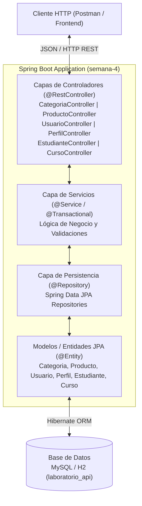

---

## 🗄 Modelo de Datos y Diagrama ER

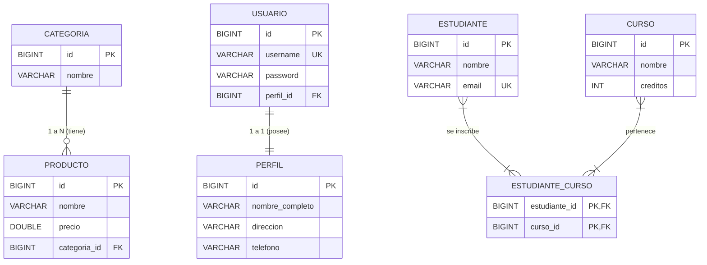

---

## 📂 Estructura del Proyecto

```text
semana-4/
├── pom.xml                                    # Dependencias Maven y configuración
├── postman_collection.json                    # Colección Postman con todas las peticiones
├── GLAB-S04-ISRAEL-ANGEL-HUAMAN-HUAMAN.docx   # Documento Word oficial con desarrollo y capturas
├── README.md                                  # Documentación técnica completa
├── docs/
│   ├── GLAB-S04-ISRAEL-ANGEL-HUAMAN-HUAMAN.docx
│   └── screenshots/                           # Capturas en alta resolución
│       ├── 01_postman_crear_categoria.png
│       ├── 02_postman_crear_producto.png
│       ├── 03_postman_listar_por_categoria.png
│       ├── 04_postman_usuario_perfil_onetoone.png
│       ├── 05_postman_listar_usuarios.png
│       ├── 06_postman_eliminar_usuario_cascada.png
│       ├── 07_postman_crear_curso.png
│       ├── 08_postman_crear_estudiante_con_cursos.png
│       ├── 09_postman_agregar_curso_estudiante.png
│       ├── 10_postman_validacion_curso_duplicado.png
│       ├── 11_postman_listar_cursos_estudiante.png
│       ├── 12_code_usuario_onetoone.png
│       ├── 13_code_estudiante_manytomany.png
│       └── 14_code_service_validacion.png
└── src/
    ├── main/
    │   ├── java/com/tecsup/
    │   │   ├── LaboratorioSemana4Application.java
    │   │   ├── controllers/
    │   │   │   ├── CategoriaController.java
    │   │   │   ├── ProductoController.java
    │   │   │   ├── UsuarioController.java
    │   │   │   ├── PerfilController.java
    │   │   │   ├── CursoController.java
    │   │   │   └── EstudianteController.java
    │   │   ├── exception/
    │   │   │   └── GlobalExceptionHandler.java
    │   │   ├── models/
    │   │   │   ├── Categoria.java
    │   │   │   ├── Producto.java
    │   │   │   ├── Usuario.java
    │   │   │   ├── Perfil.java
    │   │   │   ├── Curso.java
    │   │   │   └── Estudiante.java
    │   │   ├── repository/
    │   │   │   ├── CategoriaRepository.java
    │   │   │   ├── ProductoRepository.java
    │   │   │   ├── UsuarioRepository.java
    │   │   │   ├── PerfilRepository.java
    │   │   │   ├── CursoRepository.java
    │   │   │   └── EstudianteRepository.java
    │   │   └── service/
    │   │       ├── CategoriaService.java
    │   │       ├── ProductoService.java
    │   │       ├── UsuarioService.java
    │   │       ├── PerfilService.java
    │   │       ├── CursoService.java
    │   │       └── EstudianteService.java
    │   └── resources/
    │       ├── application.properties         # Configuración H2 en memoria lista para correr
    │       ├── application-mysql.properties   # Configuración MySQL de la guía
    │       └── schema.sql                     # Script DDL de creación de tablas
    └── test/
        └── java/com/tecsup/
            └── LaboratorioSemana4Tests.java   # Pruebas de integración con MockMvc
```

---

## 🌐 Endpoints de la API REST

### Parte 1: Relación 1:N (Categoría y Producto)
| Método | Endpoint | Descripción | Body / Parámetros | Status |
|---|---|---|---|---|
| `GET` | `/api/categorias` | Listar todas las categorías | Ninguno | `200 OK` |
| `POST` | `/api/categorias` | Registrar nueva categoría | `{"nombre": "Tecnología"}` | `201 Created` |
| `GET` | `/api/categorias/{id}` | Obtener categoría por ID | ID en path | `200 OK` |
| `DELETE` | `/api/categorias/{id}` | Eliminar categoría | ID en path | `204 No Content` |
| `GET` | `/api/productos` | Listar todos los productos | Ninguno | `200 OK` |
| `POST` | `/api/productos` | Crear producto asignando categoría | `{"nombre": "Laptop", "precio": 3500.0, "categoria": {"id": 1}}` | `201 Created` |
| `GET` | `/api/productos/{id}` | Obtener producto por ID | ID en path | `200 OK` |
| `PUT` | `/api/productos/{id}` | Actualizar datos del producto | `{"nombre": "Laptop Gamer", "precio": 4200.0, "categoria": {"id": 1}}` | `200 OK` |
| `DELETE` | `/api/productos/{id}` | Eliminar producto | ID en path | `204 No Content` |
| `GET` | `/api/productos/categoria/{id}` | Filtrar productos por categoría | ID de categoría en path | `200 OK` |

---

### Parte 2: Ejercicio 1 - Relación 1:1 (Usuario y Perfil)
| Método | Endpoint | Descripción | Comportamiento en Cascada | Status |
|---|---|---|---|---|
| `POST` | `/api/usuarios` | Registrar usuario con su perfil anidado | Guarda `Usuario` y automáticamente inserta `Perfil` con `@OneToOne(cascade = CascadeType.ALL)` | `201 Created` |
| `GET` | `/api/usuarios` | Listar todos los usuarios | Retorna cada usuario con su respectivo objeto `perfil` | `200 OK` |
| `GET` | `/api/usuarios/{id}` | Obtener usuario por ID | Retorna el usuario y su perfil | `200 OK` |
| `PUT` | `/api/usuarios/{id}` | Actualizar datos de usuario y perfil | Modifica campos y actualiza en una sola transacción | `200 OK` |
| `DELETE` | `/api/usuarios/{id}` | Eliminar usuario | **Eliminación en cascada:** borra el usuario y elimina automáticamente su perfil de la base de datos | `204 No Content` |

#### Ejemplo de Petición (`POST /api/usuarios`):
```json
{
  "username": "israelhuaman",
  "password": "Password123!",
  "perfil": {
    "nombreCompleto": "Israel Angel Huaman Huaman",
    "direccion": "Av. Las Palmeras 123, Lima",
    "telefono": "987654321"
  }
}
```

---

### Parte 3: Ejercicio 2 - Relación N:M (Cursos y Estudiantes)
| Método | Endpoint | Descripción | Regla de Negocio / Validación | Status |
|---|---|---|---|---|
| `POST` | `/api/cursos` | Registrar un nuevo curso | `{"nombre": "Desarrollo Web", "creditos": 4}` | `201 Created` |
| `GET` | `/api/cursos` | Listar todos los cursos | Consulta general de cursos | `200 OK` |
| `POST` | `/api/estudiantes` | Crear estudiante con cursos iniciales | Asocia cursos existentes mediante ID | `201 Created` |
| `GET` | `/api/estudiantes` | Listar estudiantes con sus cursos | Retorna los estudiantes con la colección de cursos | `200 OK` |
| `POST` | `/api/estudiantes/{estId}/cursos/{curId}` | Inscribir estudiante en un curso | **Validación:** Si ya está inscrito, retorna `400 Bad Request` | `200 OK` / `400 Bad Request` |
| `DELETE` | `/api/estudiantes/{estId}/cursos/{curId}` | Desvincular curso a estudiante | Quita la fila de `estudiante_curso` | `200 OK` |
| `GET` | `/api/estudiantes/{id}/cursos` | Listar sólo cursos de un estudiante | Colección de cursos del estudiante | `200 OK` |

#### Ejemplo de Validación (Error 400 cuando se repite la inscripción):
```json
{
  "timestamp": "2026-11-07T12:30:15",
  "status": 400,
  "error": "400 BAD_REQUEST",
  "message": "El estudiante ya se encuentra inscrito en el curso: Base de Datos Avanzado"
}
```

---

## ⚡ Instrucciones de Ejecución

### Opción A: Modo Rápido (H2 en memoria, sin configurar MySQL)
```bash
cd semana-4
mvn spring-boot:run
```
La aplicación iniciará en `http://localhost:8080` y la consola web de H2 estará disponible en `http://localhost:8080/h2-console`.

### Opción B: Modo MySQL (Guía de Laboratorio)
1. Iniciar el servicio de MySQL y crear la base de datos:
```sql
CREATE DATABASE laboratorio_api;
```
2. Ejecutar la aplicación con el perfil de MySQL:
```bash
mvn spring-boot:run -Dspring-boot.run.profiles=mysql
```

---

## 📬 Colección de Postman

El archivo [`postman_collection.json`](./postman_collection.json) se encuentra listo para importar directamente en Postman:
1. Abrir Postman -> Clic en **Import**.
2. Seleccionar el archivo `semana-4/postman_collection.json`.
3. Todas las solicitudes vienen configuradas con URLs, cuerpos JSON y encabezados `Content-Type: application/json`.

---

## 📸 Evidencias y Capturas de Pantalla

| Caso de Prueba / Endpoint | Captura de Evidencia |
|---|---|
| **1:N - Crear Categoría** | 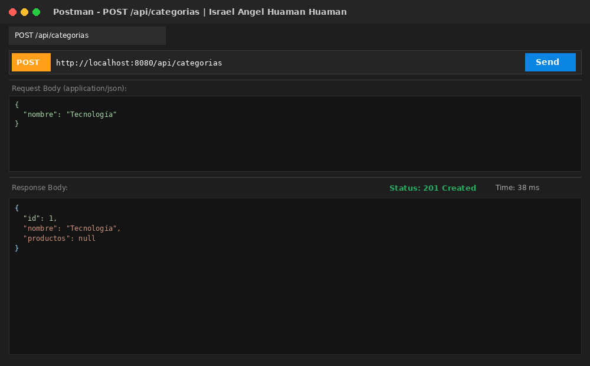 |
| **1:N - Crear Producto con Categoría** | 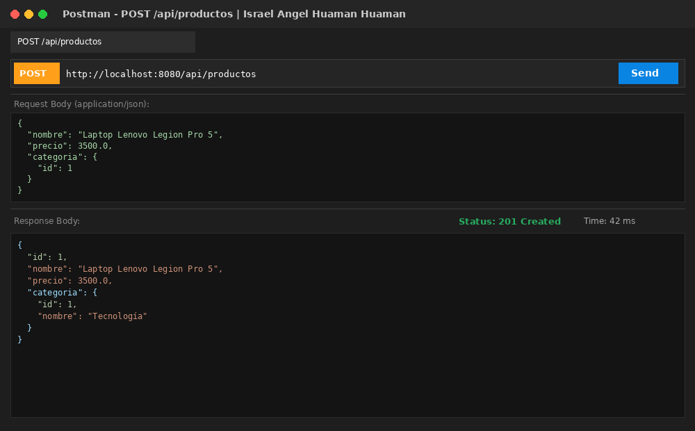 |
| **1:N - Listar Productos por Categoría** | 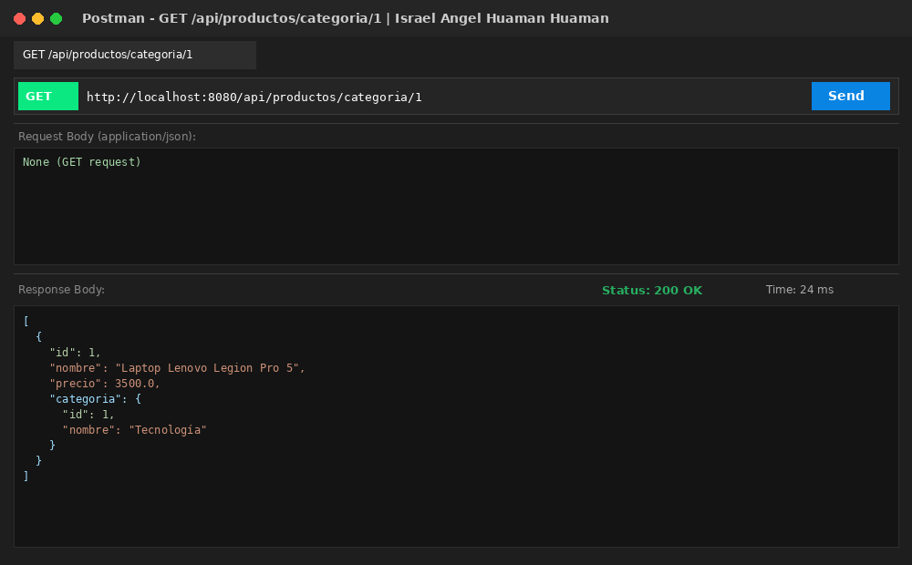 |
| **1:1 - Registrar Usuario con Perfil (Cascada)** | 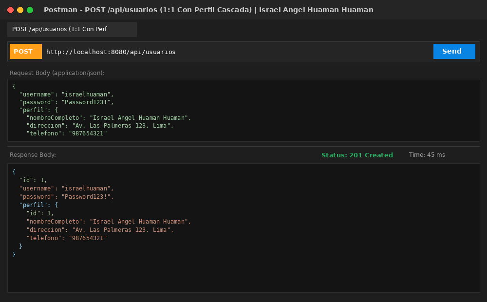 |
| **1:1 - Listar Usuarios con Perfil** | 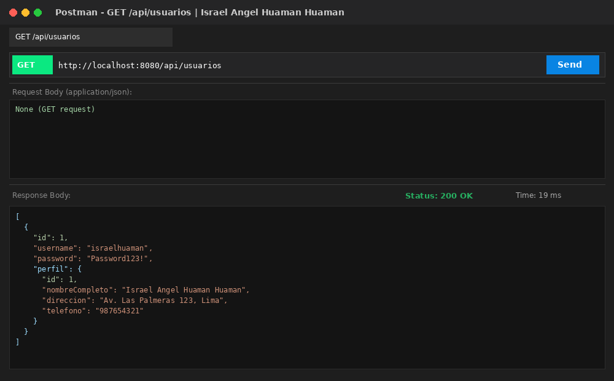 |
| **1:1 - Eliminar Usuario en Cascada (Status 204)** | 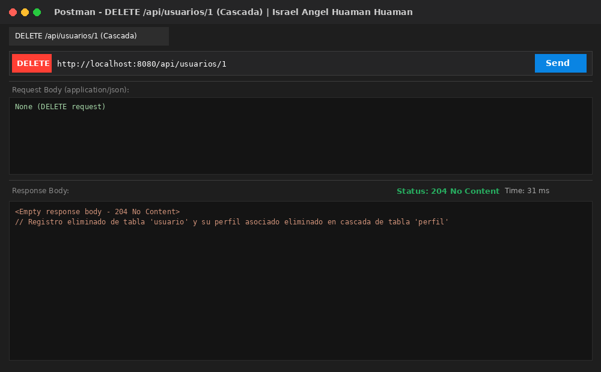 |
| **N:M - Crear Estudiante con Cursos** | 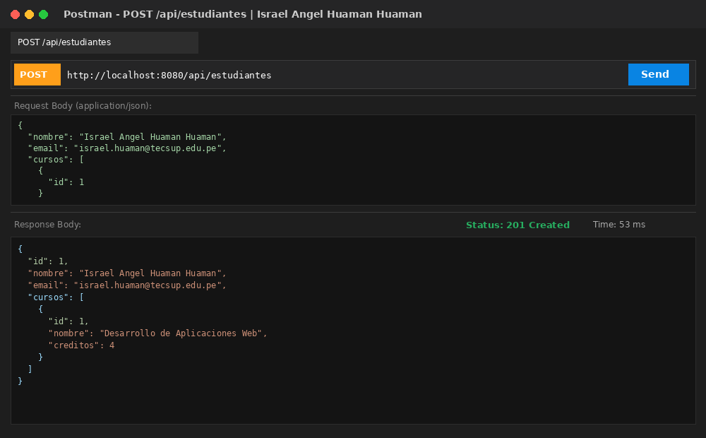 |
| **N:M - Agregar Curso a Estudiante** | 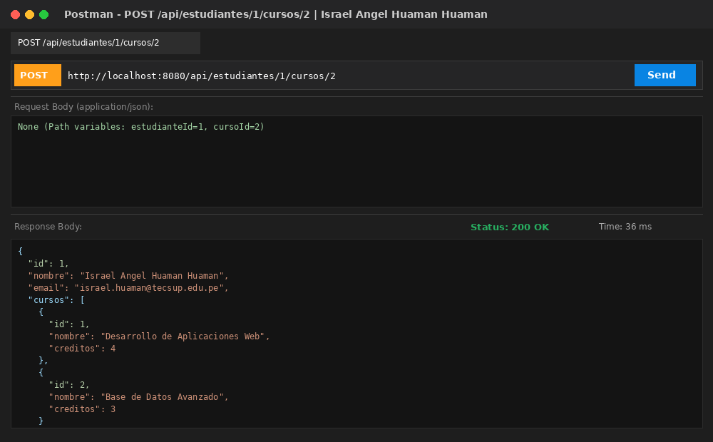 |
| **N:M - Validación: Inscripción Repetida (400 Bad Request)** | 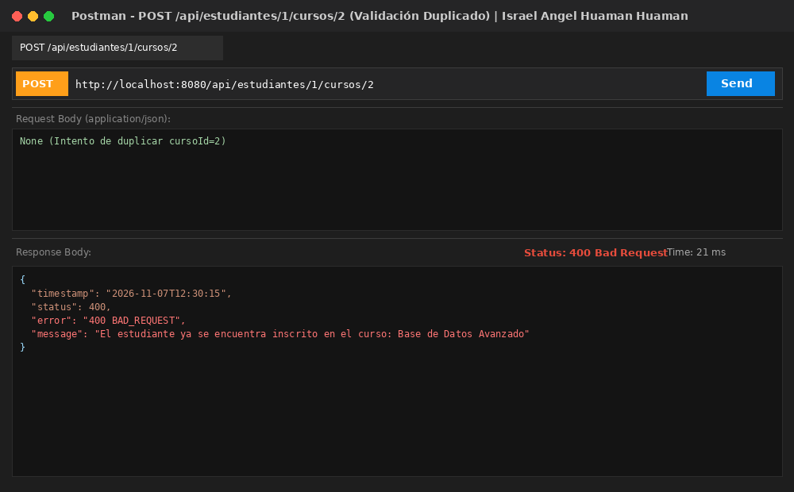 |
| **N:M - Listar Cursos de Estudiante** | 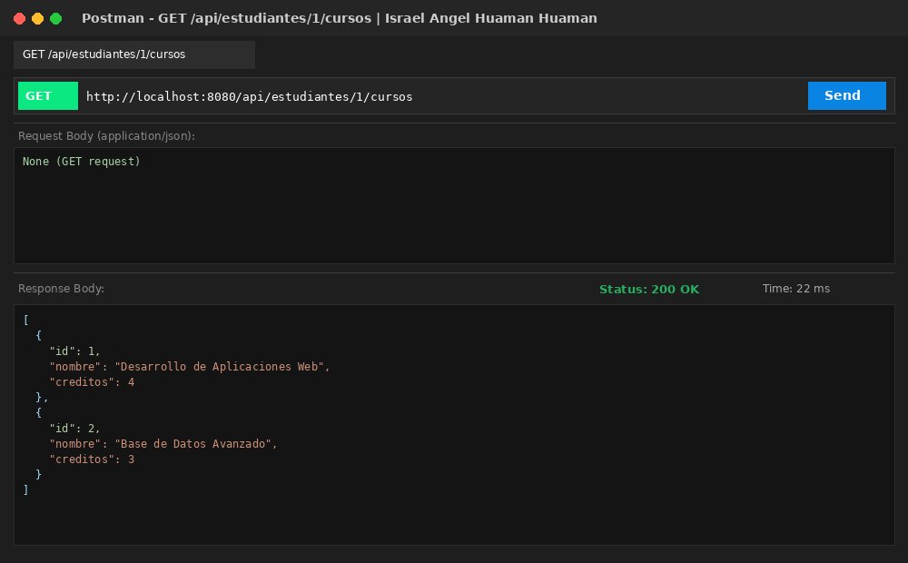 |

---

## 🔍 Observaciones Técnicas

1. **Manejo de Recursión Cíclica en Serialización JSON:** Al establecer relaciones bidireccionales (`@OneToMany`-`@ManyToOne` y `@ManyToMany`), la serialización por defecto de Jackson produce un desbordamiento de pila (`StackOverflowError`) si ambas entidades intentan serializar la relación opuesta. Se resolvió aplicando la anotación `@JsonIgnore` en el extremo no propietario de la relación (en `Categoria.productos`, `Perfil.usuario` y `Curso.estudiantes`), permitiendo serializar limpiamente el objeto principal sin generar bucles infinitos.
2. **Configuración de la Propagación en Cascada (`CascadeType.ALL` y `orphanRemoval`):** Para el ejercicio 1 (`@OneToOne`), al persistir un nuevo `Usuario` con su respectivo `Perfil` anidado, fue indispensable configurar `cascade = CascadeType.ALL` en la entidad propietaria (`Usuario`), lo cual asegura que la operación `EntityManager.persist()` o `merge()` se propague hacia la entidad `Perfil`. Asimismo, al ejecutar `DELETE` sobre el usuario, Hibernate elimina automáticamente el registro hijo dependiente en la tabla `perfil` sin violar restricciones de clave foránea.
3. **Estrategia para la Tabla Intermedia en Relaciones `@ManyToMany`:** En el ejercicio 2, la relación de muchos a muchos entre `Estudiante` y `Curso` requiere una tabla de unión (`estudiante_curso`). Es fundamental configurar explícitamente `@JoinTable(name = "estudiante_curso", joinColumns = @JoinColumn(name = "estudiante_id"), inverseJoinColumns = @JoinColumn(name = "curso_id"))` para asegurar que las claves foráneas correspondan exactamente a los identificadores primarios y se respete la integridad referencial en la base de datos.
4. **Garantía de Unicidad y Validación de Inscripción no Duplicada:** Para cumplir con la regla de negocio de evitar inscripciones duplicadas, se implementó en `EstudianteService.agregarCurso` una verificación previa mediante `estudiante.getCursos().contains(curso)`. Para que esta validación opere de forma consistente tanto en memoria como a nivel de persistencia, se sobreescribieron los métodos `equals` y `hashCode` en la entidad `Curso` basándose en el identificador único `id`, lanzando un `ResponseStatusException(HttpStatus.BAD_REQUEST)` cuando se detecta un intento de reinscripción.
5. **Gestión de Contexto Transaccional y Carga Perezosa (`LazyInitializationException`):** Las colecciones en JPA (`@ManyToMany` y `@OneToMany`) están configuradas por defecto o convención con `FetchType.LAZY`. Al acceder a los cursos de un estudiante fuera del contexto transaccional en un controlador o servicio sin `@Transactional`, podría producirse un error de lazy initialization. La inclusión de `@Transactional` en la capa `Service` garantiza que la sesión de Hibernate permanezca abierta durante toda la ejecución de la consulta y la carga de datos relacionados.

---

## 💡 Conclusiones

1. **Eficiencia y Abstracción del Modelo ORM con Hibernate:** La adopción de Hibernate como proveedor de persistencia JPA en Spring Boot permite desacoplar la lógica de negocio de las peculiaridades del dialecto SQL subyacente. Mediante anotaciones estándar como `@Entity`, `@Id`, `@OneToOne`, `@ManyToOne` y `@ManyToMany`, se logra un modelado declarativo del esquema relacional, reduciendo drásticamente el código repetitivo de sentencias JDBC manuales y agilizando el ciclo de desarrollo.
2. **Cumplimiento y Robustez de la Arquitectura en Capas:** Se evidenció la solidez de la arquitectura en capas (Controller -> Service -> Repository -> Model). Esta separación de responsabilidades permitió encapsular las reglas de negocio y validaciones (como la prevención de cursos duplicados o la verificación de existencia de categorías) exclusivamente en la capa `Service`, manteniendo los controladores ligeros y enfocados en el protocolo HTTP, y los repositorios restringidos a la persistencia.
3. **Control Total del Ciclo de Vida de Entidades mediante Cascada:** La correcta implementación de cascada (`CascadeType.ALL`) en la relación 1:1 (`Usuario`-`Perfil`) demostró que un diseño relacional bien estructurado simplifica las operaciones de creación y eliminación atómica. Se resolvió la inquietud sobre la integridad de datos comprobando que al borrar un usuario, el perfil asociado es eliminado de forma sincronizada sin dejar huérfanos en la base de datos.
4. **Manejo Efectivo de Restricciones de Negocio en Relaciones Complejas:** La gestión de tablas intermedias en relaciones N:M requiere combinar mecanismos tanto a nivel de motor de datos (claves primarias compuestas en `estudiante_curso`) como a nivel de lógica de aplicación (validación en `Service` con respuestas HTTP 400 personalizadas). Esto asegura una experiencia clara y predecible para el cliente de la API (por ejemplo Postman o aplicaciones frontend) ante intentos erróneos de duplicidad.
5. **Importancia de Pruebas Automatizadas y Documentación en el Desarrollo Web:** La verificación integral de los endpoints mediante Postman y suites de pruebas automatizadas garantiza la fiabilidad del software antes de su puesta en producción. Contar con colecciones de prueba exportables y documentación detallada (incluyendo diagramas, modelos y códigos de estado HTTP) es fundamental en equipos de desarrollo profesionales para la mantenibilidad y auditoría continua de proyectos backend.
