# 🛡️ Laboratorio Semana 5: Validación y Manejo de Errores en APIs con Spring Boot

[](https://www.oracle.com/java/)
[](https://spring.io/projects/spring-boot)
[-blue.svg)](https://beanvalidation.org/)
[](https://www.mysql.com/)

---

## 👨‍🎓 Información del Estudiante
- **Estudiante:** **Israel Angel Huaman Huaman**
- **Curso:** Desarrollo de Aplicaciones Web Avanzado (DAWA) - 4to Ciclo C24 (Sección A - B)
- **Docente:** Ricardo Coello Palomino
- **Institución:** Tecsup
- **Repositorio Oficial GitHub:** [https://github.com/israelhuamanh/daw-projects](https://github.com/israelhuamanh/daw-projects)
- **Directorio de la Tarea:** `semana-5/`
- **Documento Word Oficial:** [`GLAB-S05-ISRAEL-ANGEL-HUAMAN-HUAMAN.docx`](./GLAB-S05-ISRAEL-ANGEL-HUAMAN-HUAMAN.docx)

---

## 📑 Tabla de Contenidos
1. [Descripción del Proyecto](#-descripción-del-proyecto)
2. [Arquitectura del Sistema y Flujo de Validación](#-arquitectura-del-sistema-y-flujo-de-validación)
3. [Estructura del Proyecto](#-estructura-del-proyecto)
4. [Respuestas al Cuestionario Conceptual](#-respuestas-al-cuestionario-conceptual)
5. [Endpoints de la API REST](#-endpoints-de-la-api-rest)
6. [Instrucciones de Ejecución](#-instrucciones-de-ejecución)
7. [Colección de Postman](#-colección-de-postman)
8. [Evidencias y Capturas de Pantalla](#-evidencias-y-capturas-de-pantalla)
9. [Observaciones Técnicas](#-observaciones-técnicas)
10. [Conclusiones](#-conclusiones)

---

## 📖 Descripción del Proyecto

El presente proyecto implementa una API REST profesional en **Spring Boot 3** que aplica las mejores prácticas de la industria en **validación de datos de entrada** y **gestión centralizada de excepciones**:
1. **Patrón DTO (Data Transfer Object):** Separación limpia entre el modelo de persistencia (`Producto`) y el objeto de transferencia (`ProductoDTO`).
2. **Validación Declarativa (Bean Validation / JSR-380):** Restricciones mediante `@NotBlank`, `@Positive`, y `@Min`.
3. **Manejo Global de Errores con `@RestControllerAdvice`:** Intercepción centralizada de `MethodArgumentNotValidException` para devolver respuestas JSON estandarizadas con código `400 Bad Request`.
4. **Desarrollo de la Actividad de la Semana:**
   - Incorporación del atributo `categoria` en la entidad y el DTO.
   - Implementación de búsqueda flexible de productos por nombre mediante consultas derivadas de JPA (`findByNombreContainingIgnoreCase`).

---

## 🏛 Arquitectura del Sistema y Flujo de Validación

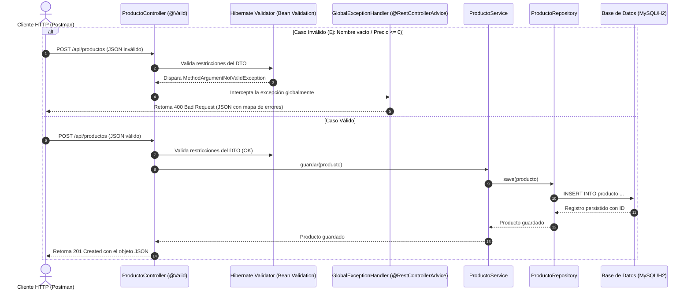

---

## 📂 Estructura del Proyecto

```text
semana-5/
├── pom.xml                                    # Dependencias Maven y configuración
├── postman_collection.json                    # Colección Postman con todas las peticiones
├── GLAB-S05-ISRAEL-ANGEL-HUAMAN-HUAMAN.docx   # Documento Word oficial con desarrollo y capturas
├── README.md                                  # Documentación técnica completa
├── docs/
│   ├── GLAB-S05-ISRAEL-ANGEL-HUAMAN-HUAMAN.docx
│   └── screenshots/                           # 15 capturas en alta resolución
│       ├── 01_postman_guardar_valido.png
│       ├── 02_postman_error_nombre_vacio.png
│       ├── 03_postman_error_precio_negativo.png
│       ├── 04_postman_error_stock_negativo.png
│       ├── 05_postman_error_categoria_vacia.png
│       ├── 06_postman_listar_productos.png
│       ├── 07_postman_obtener_por_id.png
│       ├── 08_postman_actualizar_valido.png
│       ├── 09_postman_buscar_por_nombre.png
│       ├── 10_postman_filtrar_por_categoria.png
│       ├── 11_postman_error_404_no_encontrado.png
│       ├── 12_postman_eliminar_producto.png
│       ├── 13_code_dto_validation.png
│       ├── 14_code_global_exception_handler.png
│       └── 15_code_controller_buscar.png
└── src/
    ├── main/
    │   ├── java/com/tecsup/
    │   │   ├── LaboratorioSemana5Application.java
    │   │   ├── controller/
    │   │   │   └── ProductoController.java
    │   │   ├── dto/
    │   │   │   └── ProductoDTO.java
    │   │   ├── exception/
    │   │   │   └── GlobalExceptionHandler.java
    │   │   ├── model/
    │   │   │   └── Producto.java
    │   │   ├── repository/
    │   │   │   └── ProductoRepository.java
    │   │   └── service/
    │   │       └── ProductoService.java
    │   └── resources/
    │       ├── application.properties         # Configuración H2 en memoria lista para correr
    │       ├── application-mysql.properties   # Configuración MySQL de la guía
    │       └── schema.sql                     # Script DDL de creación de tablas
    └── test/
        └── java/com/tecsup/
            └── LaboratorioSemana5Tests.java   # Pruebas de integración con MockMvc
```

---

## 🧠 Respuestas al Cuestionario Conceptual

### 1. ¿Por qué usamos un DTO en lugar de exponer directamente la entidad?
- **Desacoplamiento y Seguridad:** Evita exponer la estructura interna de la base de datos (tablas, claves foráneas, columnas sensibles) hacia clientes externos. Previene ataques de asignación masiva (*Mass Assignment / Over-posting*), impidiendo que un atacante manipule campos no autorizados como IDs autoincrementales, roles o timestamps de auditoría.
- **Validación Específica del Contexto:** Permite definir restricciones de validación (`@NotBlank`, `@Positive`, etc.) que aplican exclusivamente a la recepción de datos del cliente sin sobrecargar ni acoplar innecesariamente la entidad JPA.
- **Evolución Independiente:** Permite que la API pública evolucione sin romper contratos con clientes externos aunque cambie el esquema relacional.
- **Optimización:** Transfiere únicamente la información requerida por el cliente, reduciendo el consumo de ancho de banda y evitando bucles de serialización recursiva bidireccional.

### 2. ¿Qué función cumple `@Valid`?
La anotación `@Valid` (de `jakarta.validation.Valid`) instruye al despachador de Spring MVC para que ejecute el motor de validación Bean Validation (JSR-380 / Hibernate Validator) sobre el objeto recibido en el `@RequestBody` antes de ejecutar la lógica del controlador.  
Si alguno de los campos viola las restricciones declaradas (`@NotBlank`, `@Positive`, `@Min`), Spring interrumpe el flujo y dispara automáticamente una excepción de tipo `MethodArgumentNotValidException`, conteniendo los detalles exactos de los campos erróneos y permitiendo que el `@RestControllerAdvice` los capture y responda con HTTP 400 Bad Request.

### 3. ¿Qué pasaría si eliminamos `@RestControllerAdvice`?
- **Pérdida del Manejo Centralizado:** Sin `@RestControllerAdvice`, las excepciones lanzadas en los controladores no serían interceptadas de manera global ni uniforme.
- **Respuestas por Defecto no Controladas:** Spring Boot activaría el controlador de error por defecto (`BasicErrorController`), devolviendo páginas de error genéricas (Whitelabel Error Page en navegadores) o estructuras JSON genéricas con trazas de pila completas (*stack traces*).
- **Riesgo de Seguridad:** Exponer trazas de error sin filtrar puede revelar detalles internos de la arquitectura del servidor, rutas de clases o librerías a usuarios malintencionados.
- **Mala Experiencia de Integración:** Los clientes externos (Postman, SPAs o aplicaciones móviles) no podrían parsear de forma estandarizada los mensajes de validación de cada campo.

### 4. ¿Qué hace `@Autowired`?
Habilita la **Inyección Automática de Dependencias** dentro del contenedor de Inversión de Control (IoC) de Spring Framework. Spring busca en su `ApplicationContext` un bean administrado compatible con el tipo solicitado (por ejemplo, inyectar `ProductoRepository` en `ProductoService`, o `ProductoService` en `ProductoController`) y lo suministra automáticamente, eliminando la necesidad de instanciar objetos manualmente con el operador `new` y promoviendo el bajo acoplamiento (principio de inversión de dependencias de SOLID).

### 5. ¿Cuál es la diferencia entre `save()`, `findById()` y `findAll()`?
- **`save(S entity)`:** Inserta o actualiza un registro en la base de datos. Si la entidad no tiene ID (`id == null`), ejecuta `persist()` generando una sentencia SQL `INSERT`. Si ya tiene un ID asignado existente, ejecuta `merge()` generando una sentencia SQL `UPDATE`. Retorna la entidad gestionada y sincronizada con su ID asignado.
- **`findById(ID id)`:** Busca un único registro por su clave primaria generando un `SELECT ... WHERE id = ?`. Retorna un contenedor `Optional<T>` que previene errores de puntero nulo (`NullPointerException`) y permite encadenar métodos funcionales como `.orElse(null)` o `.orElseThrow()`.
- **`findAll()`:** Recupera la totalidad de los registros de la tabla correspondiente mediante un `SELECT ... FROM tabla`. Retorna una lista tipada `List<T>` (retorna una lista vacía `[]` si no hay registros, nunca `null`).

---

## 🌐 Endpoints de la API REST

| Método | Endpoint | Descripción | Body / Parámetros | Status |
|---|---|---|---|---|
| `GET` | `/api/productos` | Listar todos los productos | Ninguno | `200 OK` |
| `POST` | `/api/productos` | Registrar producto con DTO y validación | JSON de `ProductoDTO` | `201 Created` / `400 Bad Request` |
| `GET` | `/api/productos/{id}` | Obtener producto por ID | ID en path | `200 OK` / `404 Not Found` |
| `PUT` | `/api/productos/{id}` | Actualizar producto con DTO | ID en path + JSON | `200 OK` / `400` / `404` |
| `DELETE` | `/api/productos/{id}` | Eliminar producto por ID | ID en path | `200 OK` / `404 Not Found` |
| `GET` | `/api/productos/buscar` | **Actividad:** Buscar por nombre (Query Param) | `?nombre=Monitor` | `200 OK` |
| `GET` | `/api/productos/buscar/{nombre}` | **Actividad:** Buscar por nombre (Path Variable) | Nombre en path | `200 OK` |
| `GET` | `/api/productos/categoria/{cat}` | Filtrar productos por categoría | Categoría en path | `200 OK` |

#### Ejemplo de Petición Válida (`POST /api/productos`):
```json
{
  "nombre": "Monitor Gamer ASUS 27 pulgadas",
  "precio": 320.50,
  "stock": 15,
  "categoria": "Monitores"
}
```

#### Ejemplo de Respuesta de Error de Validación (`400 Bad Request`):
```json
{
  "timestamp": "2026-11-07T12:50:22",
  "status": 400,
  "error": "Error de Validación en los Datos de Entrada",
  "errores": {
    "nombre": "El nombre es obligatorio",
    "precio": "El precio debe ser mayor a 0"
  }
}
```

---

## ⚡ Instrucciones de Ejecución

### Opción A: Modo Rápido (H2 en memoria, sin configurar MySQL)
```bash
cd semana-5
mvn spring-boot:run
```
La aplicación iniciará en `http://localhost:8080` y la consola web de H2 estará disponible en `http://localhost:8080/h2-console`.

### Opción B: Modo MySQL (Guía de Laboratorio)
1. Iniciar el servicio de MySQL y crear la base de datos:
```sql
CREATE DATABASE laboratorio_api;
```
2. Ejecutar la aplicación con el perfil de MySQL:
```bash
mvn spring-boot:run -Dspring-boot.run.profiles=mysql
```

---

## 📬 Colección de Postman

El archivo [`postman_collection.json`](./postman_collection.json) se encuentra listo para importar directamente en Postman:
1. Abrir Postman -> Clic en **Import**.
2. Seleccionar el archivo `semana-5/postman_collection.json`.
3. Contiene dos carpetas organizadas:
   - **1. Peticiones Válidas (Casos de Éxito)**: CRUD completo, búsquedas y filtros.
   - **2. Pruebas de Validación y Errores (Casos Inválidos)**: Casos de nombre vacío, precio negativo, stock menor a cero, categoría vacía y recurso 404.

---

## 📸 Evidencias y Capturas de Pantalla

| Caso de Prueba / Endpoint | Captura de Evidencia |
|---|---|
| **POST - Guardar Válido (201 Created)** | 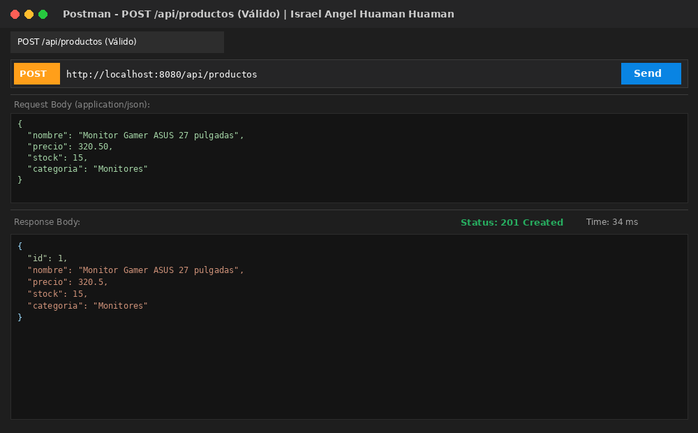 |
| **POST - Error @NotBlank Nombre (400 Bad Request)** | 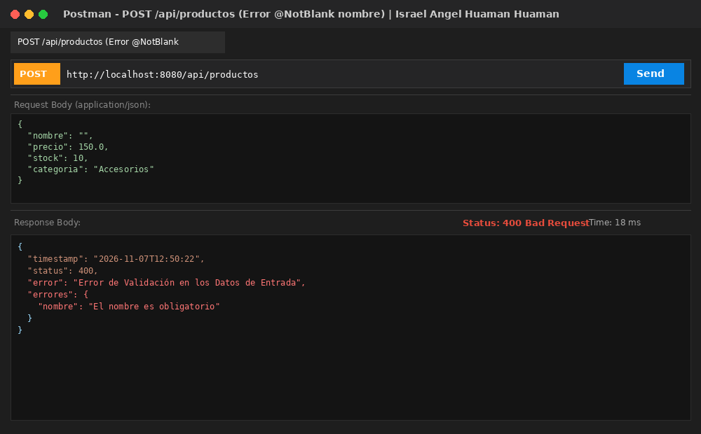 |
| **POST - Error @Positive Precio (400 Bad Request)** | 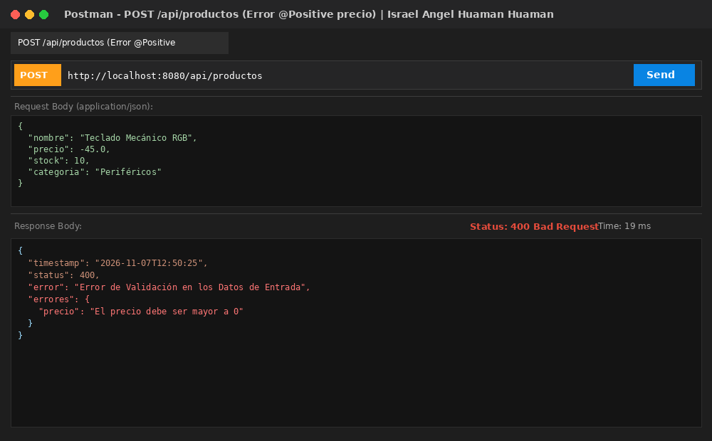 |
| **POST - Error @Min Stock (400 Bad Request)** | 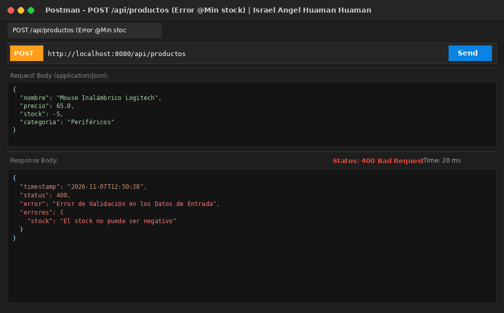 |
| **POST - Error @NotBlank Categoría (400 Bad Request)** | 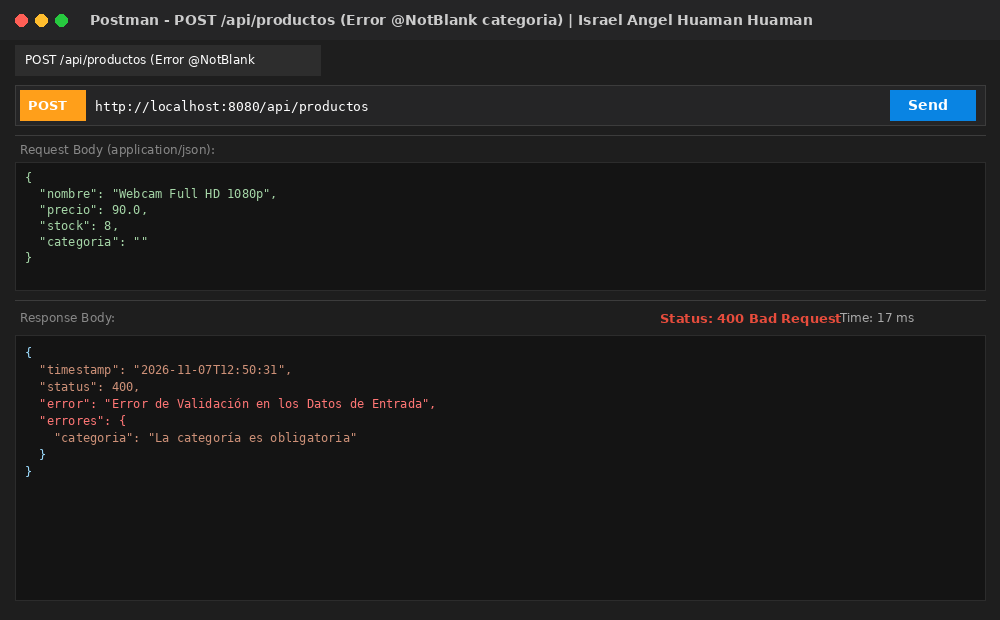 |
| **GET - Listar Productos (200 OK)** | 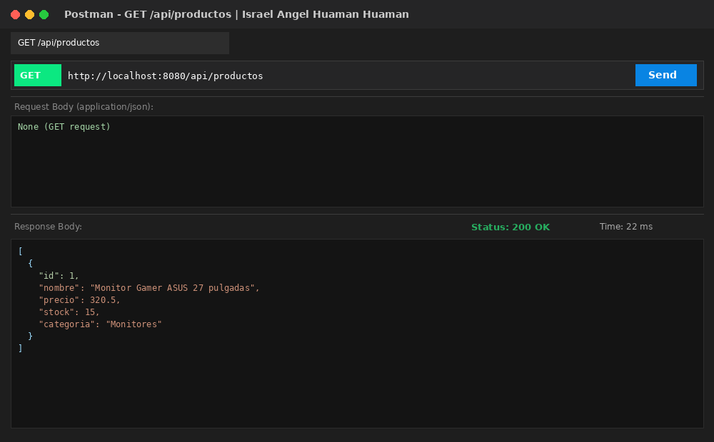 |
| **GET - Obtener por ID (200 OK)** | 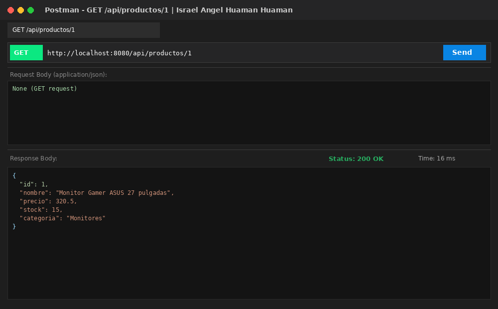 |
| **PUT - Actualizar Producto (200 OK)** | 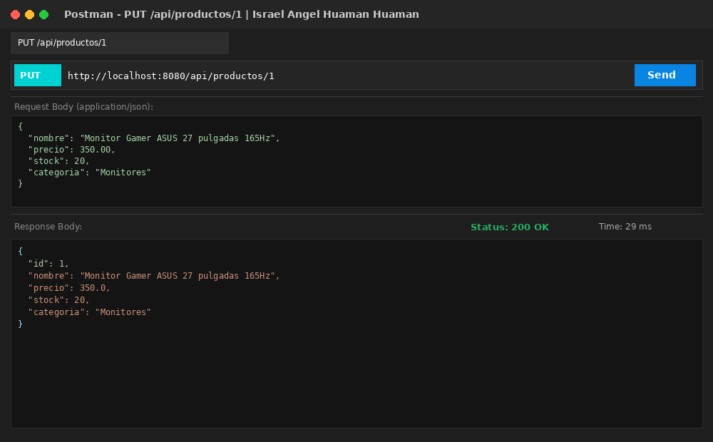 |
| **GET - Actividad: Buscar por Nombre (200 OK)** | 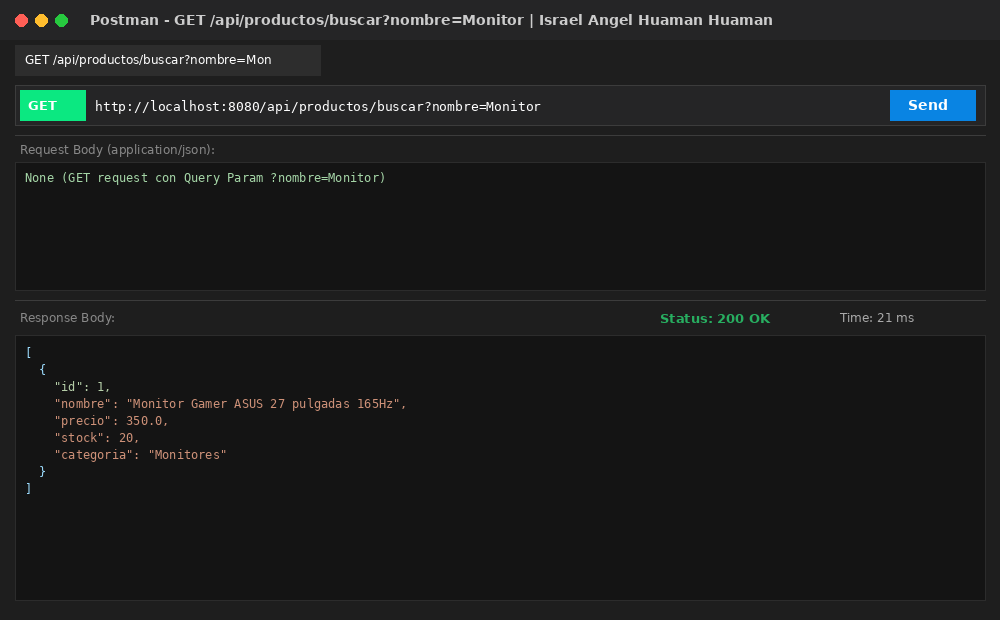 |
| **GET - Error 404 Producto No Encontrado** | 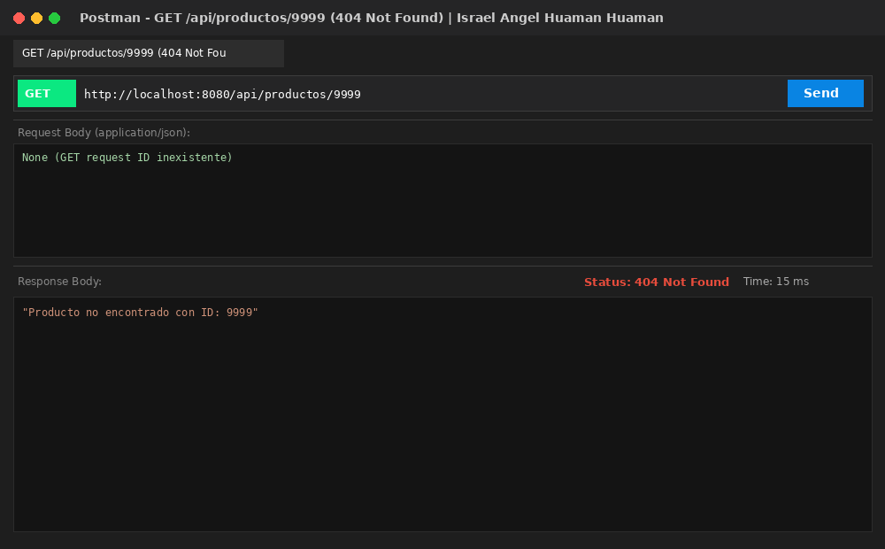 |
| **DELETE - Eliminar Producto (200 OK)** | 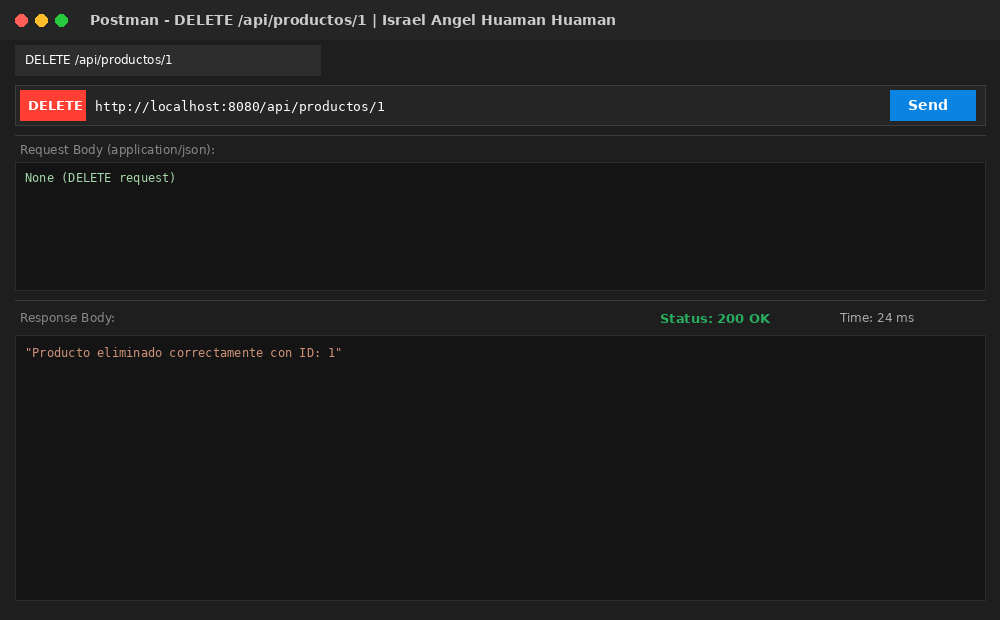 |

---

## 🔍 Observaciones Técnicas

1. **Separación de Responsabilidades mediante DTOs:** La adopción de `ProductoDTO` desacopló la entidad JPA `Producto` del contrato de transporte de la API REST. Esto impidió exponer atributos internos autoincrementales en el cuerpo de entrada y permitió aplicar validaciones declarativas estrictas antes de instanciar o modificar la entidad de dominio.
2. **Estandarización de Respuestas de Error con `@RestControllerAdvice`:** Se observó que al ocurrir una falla de validación, Spring dispara `MethodArgumentNotValidException`. Mediante `@RestControllerAdvice` y `@ExceptionHandler`, se interceptó este evento extrayendo cada campo inválido con su mensaje personalizado (`getBindingResult().getFieldErrors()`), respondiendo con un HTTP 400 limpio y fácil de interpretar por el cliente.
3. **Validación Granular con Bean Validation:** Las anotaciones `@NotBlank`, `@Positive` y `@Min` permitieron validar tipos de datos, nulidad, espacios en blanco y rangos numéricos directamente a nivel declarativo, evitando código condicional repetitivo (`if/else`) dentro de los métodos del controlador o servicio.
4. **Implementación de Búsqueda Flexible por Nombre en JPA:** En la capa repository, se definió el método derivado `findByNombreContainingIgnoreCase(String nombre)`. Esta convención de Spring Data JPA genera automáticamente una cláusula SQL `LIKE %nombre%` no sensible a mayúsculas ni minúsculas, garantizando una búsqueda amigable y tolerante para el usuario final.
5. **Manejo del Código de Estado HTTP 404:** Se implementó una verificación explícita en `GET /api/productos/{id}`, `PUT /api/productos/{id}` y `DELETE /api/productos/{id}` para validar si el producto existe antes de intentar consultar, modificar o eliminar. Al no existir, se retorna `HttpStatus.NOT_FOUND` con un mensaje claro, previniendo excepciones no controladas de base de datos.

---

## 💡 Conclusiones

1. **Incremento de la Calidad y Seguridad de la API REST:** La validación exhaustiva en el punto de entrada previene que datos corruptos, incompletos o malintencionados lleguen a la capa de persistencia, asegurando la consistencia e integridad de la base de datos relacional.
2. **Eficiencia en la Experiencia de Consumo de la API (DX):** La centralización del manejo de excepciones permite que cualquier consumidor de la API (clientes móviles, frontends Angular/React o Postman) reciba siempre una estructura predecible de error ante fallos de validación, indicando con exactitud qué campos fallaron y el motivo.
3. **Mantenibilidad y Escalabilidad del Código Backend:** El uso de DTOs combinado con la arquitectura en capas (Controller -> Service -> Repository -> Model) garantiza un código altamente mantenible, desacoplado y fácil de testear o extender con nuevas reglas de negocio sin alterar contratos previos.
4. **Productividad con Spring Data JPA:** La capacidad de declarar consultas derivadas por nombres de método (como `findByNombreContainingIgnoreCase`) reduce drásticamente la necesidad de redactar sentencias SQL nativas manuales, acelerando el desarrollo de endpoints de búsqueda y filtrado.
5. **Relevancia de Pruebas con Datos Límite:** Probar sistemáticamente escenarios válidos e inválidos en Postman comprobó la resiliencia del servicio ante datos en los límites (valores cero, negativos, cadenas vacías), confirmando que el backend responde con los códigos HTTP semánticos correctos (201, 200, 400, 404).
