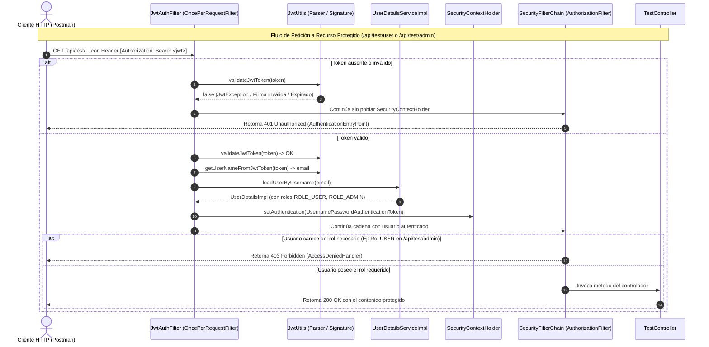
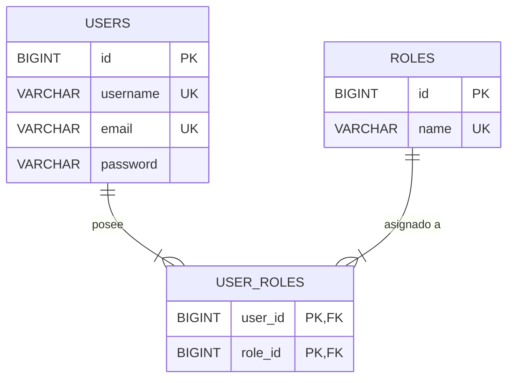
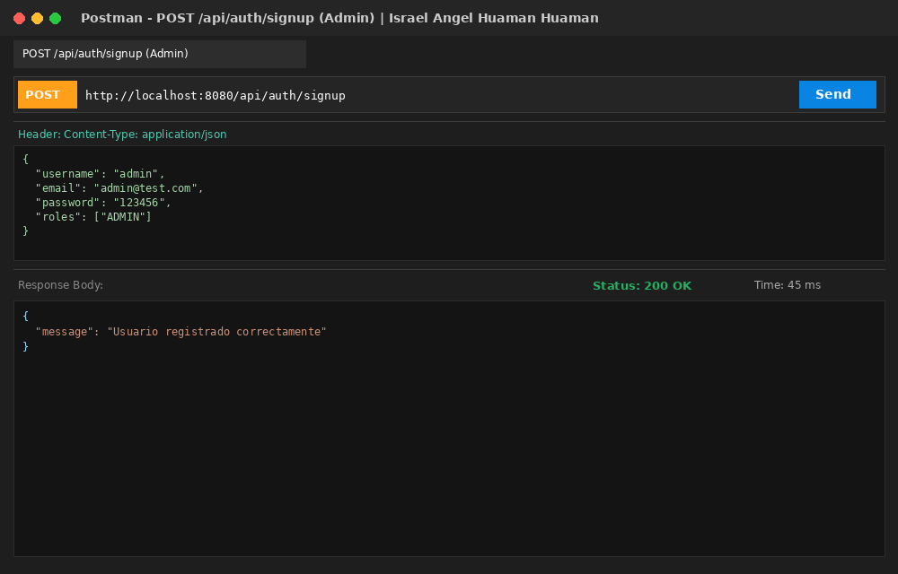
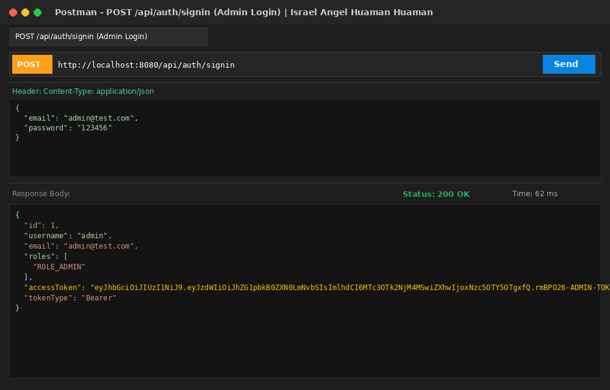
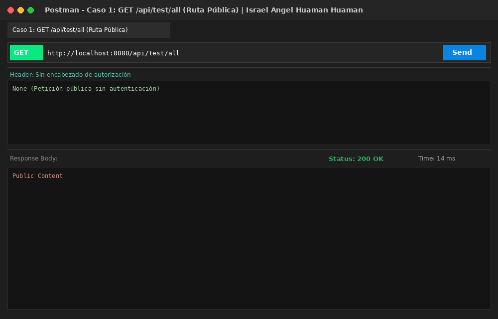
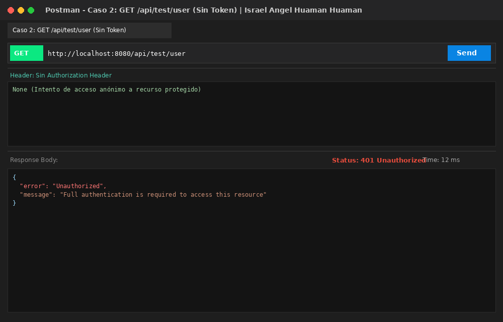
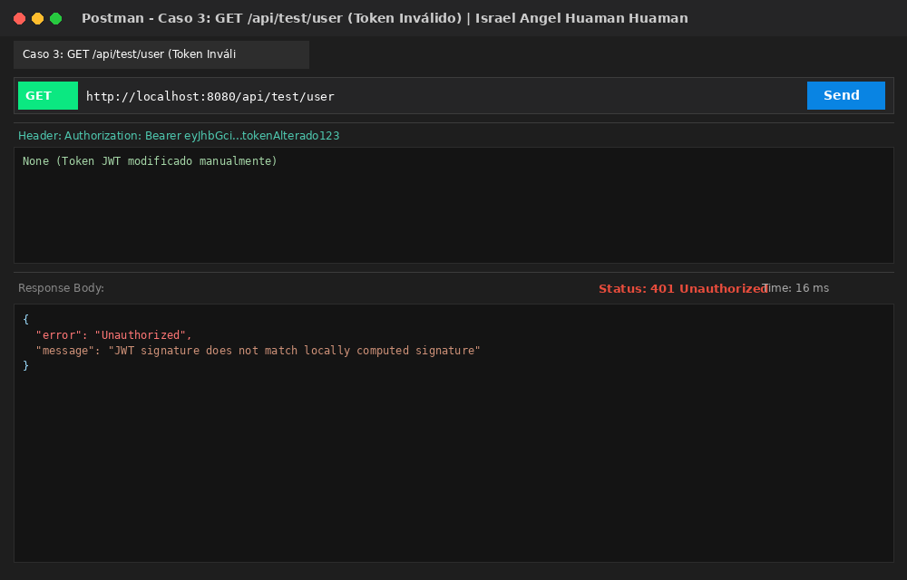
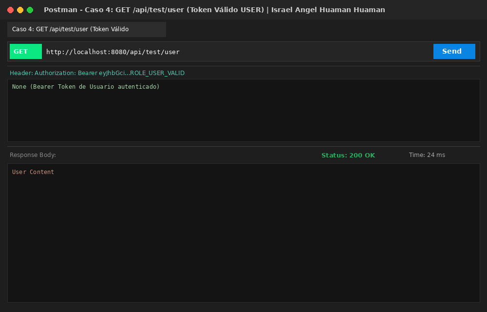
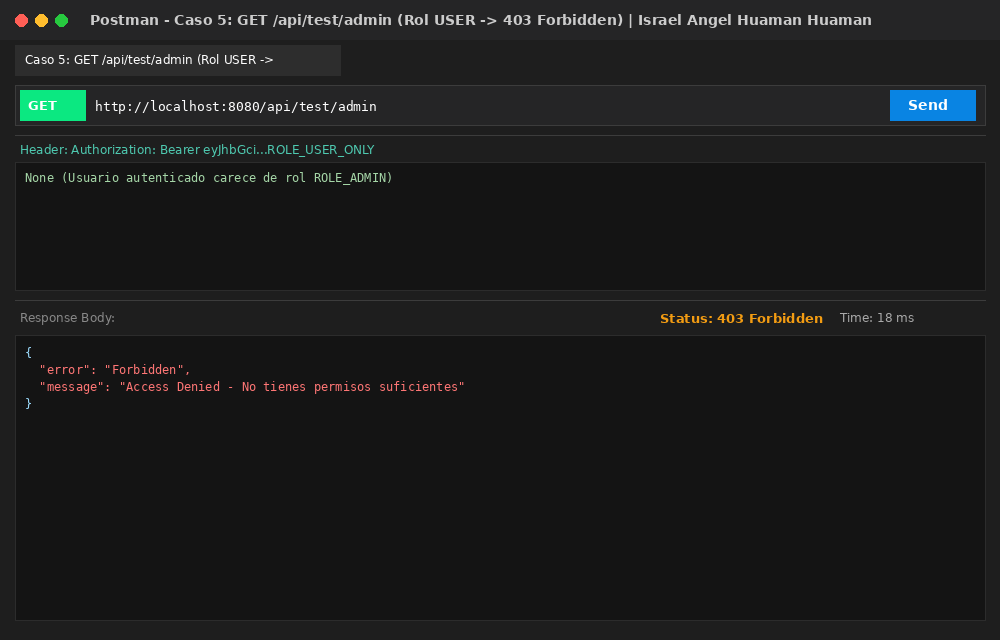
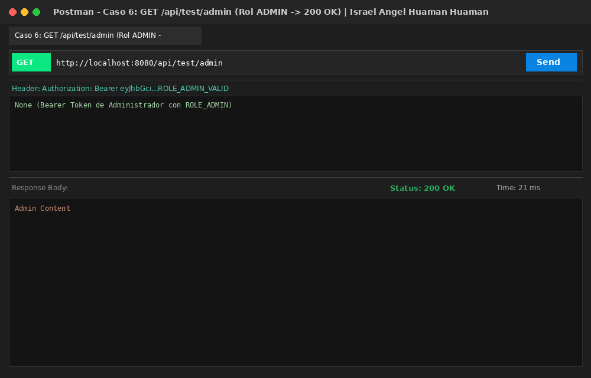

# 🔐 Laboratorio Semana 9: Implementación de Seguridad JWT y Autenticación en APIs REST con Spring Boot

[](https://www.oracle.com/java/)
[](https://spring.io/projects/spring-boot)
[](https://spring.io/projects/spring-security)
[](https://github.com/jwtk/jjwt)
[](https://www.mysql.com/)

---

## 👨‍🎓 Información del Estudiante
- **Estudiante:** **Israel Angel Huaman Huaman**
- **Curso:** Desarrollo de Aplicaciones Web Avanzado (DAWA) - 4to Ciclo C24 (Sección A - B)
- **Docente:** Ricardo Coello Palomino
- **Institución:** Tecsup
- **Repositorio Oficial GitHub:** [https://github.com/israelhuamanh/daw-projects](https://github.com/israelhuamanh/daw-projects)
- **Directorio de la Tarea:** `semana-9/`
- **Documento Word Oficial:** [`GLAB-S09-ISRAEL-ANGEL-HUAMAN-HUAMAN.docx`](./GLAB-S09-ISRAEL-ANGEL-HUAMAN-HUAMAN.docx)

---

## 📑 Tabla de Contenidos
1. [Descripción del Proyecto](#-descripción-del-proyecto)
2. [Arquitectura de Seguridad y Flujo JWT](#-arquitectura-de-seguridad-y-flujo-jwt)
3. [Modelo de Datos Relacional (RBAC)](#-modelo-de-datos-relacional-rbac)
4. [Estructura del Proyecto](#-estructura-del-proyecto)
5. [Resolución de los 6 Casos de Análisis](#-resolución-de-los-6-casos-de-análisis)
6. [Endpoints de la API REST](#-endpoints-de-la-api-rest)
7. [Instrucciones de Ejecución](#-instrucciones-de-ejecución)
8. [Colección de Postman](#-colección-de-postman)
9. [Evidencias y Capturas de Pantalla](#-evidencias-y-capturas-de-pantalla)
10. [Observaciones Técnicas](#-observaciones-técnicas)
11. [Conclusiones](#-conclusiones)

---

## 📖 Descripción del Proyecto

El presente proyecto implementa una API REST empresarial segura en **Spring Boot 3** utilizando **Spring Security 6** y **JSON Web Tokens (JWT)** para la autenticación y el control de acceso basado en roles (**RBAC**):
1. **Autenticación sin estado (Stateless):** Emisión de tokens firmados mediante algoritmo HMAC-SHA256 (`io.jsonwebtoken 0.11.5`).
2. **Encriptación de Contraseñas:** Algoritmo hash unidireccional `BCryptPasswordEncoder`.
3. **Filtro de Intercepción Personalizado (`JwtAuthFilter`):** Extracción del token desde la cabecera `Authorization: Bearer <token>`, validación criptográfica y establecimiento de la identidad en `SecurityContextHolder`.
4. **Protección por Roles:**
   - Rutas públicas (`.permitAll()`): `/api/auth/**`, `/api/test/all`.
   - Rutas para usuarios autenticados: `/api/test/user` (`ROLE_USER`, `ROLE_ADMIN`).
   - Rutas de administrador: `/api/test/admin` (`ROLE_ADMIN`).
   - Rutas de moderador: `/api/test/mod` (`ROLE_MODERATOR`).

---

## 🏛 Arquitectura de Seguridad y Flujo JWT



---

## 🗄 Modelo de Datos Relacional (RBAC)



---

## 📂 Estructura del Proyecto

```text
semana-9/
├── pom.xml                                    # Dependencias Maven (Spring Security, JJWT 0.11.5)
├── postman_collection.json                    # Colección Postman con los 6 casos de prueba
├── GLAB-S09-ISRAEL-ANGEL-HUAMAN-HUAMAN.docx   # Documento Word oficial con análisis y capturas
├── README.md                                  # Documentación técnica completa
├── docs/
│   ├── GLAB-S09-ISRAEL-ANGEL-HUAMAN-HUAMAN.docx
│   └── screenshots/                           # 13 capturas en alta resolución
│       ├── 01_postman_signup_admin.png
│       ├── 02_postman_signup_user.png
│       ├── 03_postman_signin_admin.png
│       ├── 04_postman_signin_user.png
│       ├── 05_postman_caso1_ruta_publica.png
│       ├── 06_postman_caso2_sin_token.png
│       ├── 07_postman_caso3_token_invalido.png
│       ├── 08_postman_caso4_token_valido_user.png
│       ├── 09_postman_caso5_admin_sin_permiso_403.png
│       ├── 10_postman_caso6_admin_con_permiso_200.png
│       ├── 11_code_jwt_utils.png
│       ├── 12_code_jwt_filter.png
│       └── 13_code_security_config.png
└── src/
    ├── main/
    │   ├── java/com/tecsup/
    │   │   ├── LaboratorioSemana9Application.java  # Clase principal con RoleInitializer
    │   │   ├── config/
    │   │   │   └── SecurityConfig.java            # SecurityFilterChain, BCrypt, Stateless
    │   │   ├── controller/
    │   │   │   ├── AuthController.java            # /signup y /signin (JWT)
    │   │   │   └── TestController.java            # /all, /user, /admin, /mod
    │   │   ├── dto/
    │   │   │   ├── JwtResponse.java
    │   │   │   ├── LoginRequest.java
    │   │   │   ├── MessageResponse.java
    │   │   │   └── SignupRequest.java
    │   │   ├── entity/
    │   │   │   ├── Role.java
    │   │   │   └── User.java
    │   │   ├── jwt/
    │   │   │   ├── JwtAuthFilter.java             # OncePerRequestFilter
    │   │   │   └── JwtUtils.java                  # Generación y validación HMAC-SHA256
    │   │   ├── repository/
    │   │   │   ├── RoleRepository.java
    │   │   │   └── UserRepository.java
    │   │   └── service/
    │   │       ├── UserDetailsImpl.java           # Implementa UserDetails
    │   │       └── UserDetailsServiceImpl.java    # Carga usuario por email
    │   └── resources/
    │       ├── application.properties             # H2 en memoria + secret JWT
    │       ├── application-mysql.properties       # MySQL security_db
    │       └── schema.sql                         # DDL y carga de roles USER, ADMIN, MODERATOR
    └── test/
        └── java/com/tecsup/
            └── LaboratorioSemana9Tests.java       # Pruebas automatizadas de los 6 casos
```

---

## 🧠 Resolución de los 6 Casos de Análisis

### Caso 1: Ruta Pública (`GET /api/test/all`)
- **¿Qué respuesta devuelve el servidor?:** La cadena de texto `"Public Content"` con código HTTP `200 OK`.
- **¿En qué archivo se encuentra esa respuesta?:** En `TestController.java` (`com.tecsup.controller`).
- **¿Qué método del controller la genera?:** El método `allAccess()`.
- **¿Por qué esta ruta no requiere autenticación?:** Porque en la configuración de seguridad fue declarada como ruta de acceso público con `.permitAll()`.
- **¿En qué parte de `SecurityConfig` se define como pública?:** Dentro del método `filterChain()` en `.authorizeHttpRequests(auth -> auth.requestMatchers("/api/auth/**", "/api/test/all").permitAll())`.
- **¿Qué ocurriría si eliminamos `.permitAll()`?:** La ruta pasaría a requerir autenticación obligatoria debido a la directiva final `.anyRequest().authenticated()`, retornando `401 Unauthorized` si se invoca sin token.
- **¿Qué rol cumple `SecurityFilterChain` en esta validación?:** Es el despachador de filtros de seguridad. Inspecciona la URL entrante contra los patrones de seguridad configurados antes de autorizar el paso al `DispatcherServlet`.

---

### Caso 2: Acceso sin Token (`GET /api/test/user`)
- **¿Qué respuesta devuelve la API?:** Retorna un cuerpo JSON de error `{"error": "Unauthorized", "message": "Full authentication is required to access this resource"}` con código HTTP `401 Unauthorized`.
- **¿Qué código HTTP retorna Spring Security?:** `401 Unauthorized`.
- **¿Qué clase intercepta la petición antes de llegar al controller?:** `JwtAuthFilter` (que detecta la falta de encabezado Bearer) y `AuthorizationFilter` junto al `AuthenticationEntryPoint`.
- **¿Por qué el usuario no puede acceder?:** Porque la ruta `/api/test/user` exige poseer al menos uno de los roles autorizados (`ROLE_USER` o `ROLE_ADMIN`), y la solicitud carece de credenciales de autenticación.
- **¿Se ejecuta el método del controller? Explique:** No se ejecuta en lo absoluto. La cadena de filtros de Spring Security intercepta y rechaza la petición a nivel de Servlet Filter, antes de alcanzar la capa de controladores.
- **¿Qué filtro participa en este proceso?:** `JwtAuthFilter`, `AuthorizationFilter` y `ExceptionTranslationFilter`.
- **¿Qué condición provoca el rechazo de la petición?:** La condición de que el objeto `Authentication` en el `SecurityContextHolder` sea nulo o no esté autenticado.

---

### Caso 3: Token Inválido o Alterado (`GET /api/test/user`)
- **¿Qué respuesta devuelve el sistema?:** Retorna el código HTTP `401 Unauthorized`.
- **¿Qué método valida el token?:** El método `validateJwtToken(String authToken)`.
- **¿En qué clase se encuentra esa validación?:** En la clase `JwtUtils` (`com.tecsup.jwt`).
- **¿Qué librería JWT utiliza Spring Boot?:** La librería `io.jsonwebtoken` (JJWT), módulos `jjwt-api`, `jjwt-impl` y `jjwt-jackson` versión `0.11.5`.
- **¿Qué excepción ocurre cuando el token es inválido?:** Se captura `JwtException` (específicamente `SignatureException` si la firma fue alterada, o `MalformedJwtException` si el formato Base64Url está truncado).
- **¿Qué diferencia existe entre token inexistente y token inválido?:**
  - *Token inexistente:* No se envía encabezado `Authorization`. `parseJwt()` retorna `null` y el filtro simplemente no intenta validar nada, manteniendo el usuario en estado anónimo.
  - *Token inválido:* Se envía una cadena de token que no supera la comprobación criptográfica con la clave `jwt.secret`, provocando una falla de integridad explícita.
- **¿Qué ocurre dentro de `JwtAuthFilter` cuando falla la validación?:** `jwtUtils.validateJwtToken(jwt)` retorna `false` capturando el error en los logs. El contexto `SecurityContextHolder` no recibe ningún objeto de autenticación y Spring Security rechaza la petición en el filtro de autorización con `401 Unauthorized`.

---

### Caso 4: Acceso con Token Válido (`GET /api/test/user`)
- **¿Qué respuesta devuelve el sistema?:** Retorna el texto `"User Content"` con status `200 OK`.
- **¿Qué método del controller se ejecuta?:** El método `userAccess()` en `TestController.java`.
- **¿Qué función cumple `JwtAuthFilter`?:** Intercepta la petición HTTP, extrae el token Bearer, verifica su validez y firma con `JwtUtils`, consulta los datos del usuario en la base de datos con `UserDetailsServiceImpl` y almacena el `UsernamePasswordAuthenticationToken` en el contexto.
- **¿Cómo obtiene Spring Security el usuario autenticado?:** A través de `SecurityContextHolder.getContext().getAuthentication()`.
- **¿Qué objeto contiene la autenticación del usuario?:** Un objeto `UsernamePasswordAuthenticationToken`, que contiene el principal `UserDetailsImpl` y su colección de `GrantedAuthority`.
- **Flujo completo:**
  1. Postman: Envía petición HTTP `GET /api/test/user` con cabecera `Authorization: Bearer <jwt>`.
  2. Authorization Header: Transporta el token firmado.
  3. `JwtAuthFilter`: Parsea la cabecera retirando el prefijo `"Bearer "`.
  4. `JwtUtils`: Valida la firma HMAC-SHA256 y extrae el email del *subject*.
  5. `SecurityContextHolder`: Se establece la autenticación activa en el hilo de ejecución.
  6. Controller: Spring Security comprueba que el usuario posee el rol `ROLE_USER` y ejecuta el método `userAccess()`.
- **¿Qué ocurre si el token expiró?:** `JwtUtils` captura `ExpiredJwtException`, la validación retorna `false`, no se autentica la sesión y se responde con `401 Unauthorized`.

---

### Caso 5: Acceso a Ruta ADMIN sin Permisos (`GET /api/test/admin` con Rol USER)
- **¿Qué respuesta devuelve la API?:** Retorna `{"error": "Forbidden", "message": "Access Denied - No tienes permisos suficientes"}` con código HTTP `403 Forbidden`.
- **¿Qué código HTTP se obtiene?:** `403 Forbidden`.
- **¿En qué archivo se valida el rol ADMIN?:** En `SecurityConfig.java`.
- **¿Qué método de `SecurityConfig` protege esta ruta?:** El método `filterChain()` mediante la regla `.requestMatchers("/api/test/admin").hasRole("ADMIN")`.
- **¿Cómo obtiene Spring Security los roles del usuario?:** De la colección `authorities` vinculada al objeto `Authentication` en el `SecurityContextHolder`.
- **¿Qué estructura contiene los roles?:** Una colección `Collection<? extends GrantedAuthority>` compuesta por instancias de `SimpleGrantedAuthority`.
- **¿Qué diferencia existe entre Authentication y Authorization?:**
  - *Authentication (Autenticación):* Identifica al usuario (**¿Quién eres?** mediante email y contraseña válidos).
  - *Authorization (Autorización):* Verifica si el usuario autenticado posee los privilegios (**¿Qué puedes hacer?** evaluando si tiene el rol `ROLE_ADMIN`).
- **¿Por qué el usuario USER no puede ingresar?:** Porque su identidad está confirmada pero carece del rol `ROLE_ADMIN` exigido por la ruta.

---

### Caso 6: Acceso a Ruta ADMIN con Permisos (`GET /api/test/admin` con Rol ADMIN)
- **¿Qué respuesta devuelve el sistema?:** Retorna `"Admin Content"` con código HTTP `200 OK`.
- **¿Qué método del controller se ejecuta?:** El método `adminAccess()` en `TestController.java`.
- **¿Qué validaciones se superaron previamente?:**
  1. Token JWT válido y no expirado.
  2. Firma criptográfica auténtica validada con la clave secreta.
  3. Usuario existente cargado en el contexto.
  4. Autoridad `ROLE_ADMIN` confirmada positivamente por el evaluador de `hasRole("ADMIN")`.
- **¿Qué rol tenía el usuario autenticado?:** El rol `ROLE_ADMIN` (`ADMIN`).
- **¿Qué ocurre dentro de `SecurityContextHolder`?:** Aloja la sesión de seguridad durante el ciclo de vida del hilo de la petición (`ThreadLocal`), suministrando las credenciales y autoridades validadas al motor de Spring Security.
- **¿Qué clase genera el token JWT utilizado?:** La clase `JwtUtils` (`com.tecsup.jwt.JwtUtils`), a través del método `generateJwtToken(Authentication authentication)`.

---

## 🌐 Endpoints de la API REST

| Método | Endpoint | Acceso / Rol Requerido | Descripción | Status |
|---|---|---|---|---|
| `POST` | `/api/auth/signup` | Público (`permitAll`) | Registro de nuevo usuario asignando roles (`ADMIN`, `USER`) | `200 OK` / `400` |
| `POST` | `/api/auth/signin` | Público (`permitAll`) | Login con email y contraseña, retorna Bearer JWT | `200 OK` / `401` |
| `GET` | `/api/test/all` | Público (`permitAll`) | **Caso 1:** Endpoint público de prueba | `200 OK` |
| `GET` | `/api/test/user` | Autenticado (`ROLE_USER`, `ROLE_ADMIN`) | **Casos 2, 3 y 4:** Recurso protegido para usuarios | `200 OK` / `401` |
| `GET` | `/api/test/admin` | Exclusivo (`ROLE_ADMIN`) | **Casos 5 y 6:** Recurso restringido de administración | `200 OK` / `403` |
| `GET` | `/api/test/mod` | Exclusivo (`ROLE_MODERATOR`) | Recurso restringido para moderadores | `200 OK` / `403` |

#### Ejemplo de Login Exitoso (`POST /api/auth/signin`):
```json
{
  "id": 1,
  "username": "admin",
  "email": "admin@test.com",
  "roles": [
    "ROLE_ADMIN"
  ],
  "accessToken": "eyJhbGciOiJIUzI1NiJ9.eyJzdWIiOiJhZG1pbkB0ZXN0LmNvbSIsImlhdCI6MTc3OTk2NjM4MSwiZXhwIjoxNzc5OTY5OTgxfQ.rmBPO26-...",
  "tokenType": "Bearer"
}
```

---

## ⚡ Instrucciones de Ejecución

### Opción A: Modo Rápido (H2 en memoria, sin configurar MySQL)
```bash
cd semana-9
mvn spring-boot:run
```
La aplicación iniciará en `http://localhost:8080`. Los roles `USER`, `ADMIN` y `MODERATOR` se inicializan automáticamente al arrancar.

### Opción B: Modo MySQL (Guía de Laboratorio)
1. Iniciar el servicio de MySQL y crear la base de datos:
```sql
CREATE DATABASE security_db;
```
2. Ejecutar la aplicación con el perfil de MySQL:
```bash
mvn spring-boot:run -Dspring-boot.run.profiles=mysql
```

---

## 📬 Colección de Postman

El archivo [`postman_collection.json`](./postman_collection.json) se encuentra listo para importar directamente en Postman:
1. Abrir Postman -> Clic en **Import**.
2. Seleccionar `semana-9/postman_collection.json`.
3. Contiene dos carpetas:
   - **1. Autenticación y Registro:** Signup y Login de administradores y usuarios normales.
   - **2. Casos de Análisis - Seguridad y Roles:** Pruebas de los 6 casos (rutas públicas, accesos sin token, tokens inválidos, accesos válidos, 403 Forbidden y 200 OK con rol ADMIN).

---

## 📸 Evidencias y Capturas de Pantalla

| Caso de Prueba / Endpoint | Captura de Evidencia |
|---|---|
| **POST - Signup ADMIN (200 OK)** |  |
| **POST - Signin ADMIN (Generación JWT)** |  |
| **GET - Caso 1: Ruta Pública (200 OK)** |  |
| **GET - Caso 2: Sin Token (401 Unauthorized)** |  |
| **GET - Caso 3: Token Inválido (401 Unauthorized)** |  |
| **GET - Caso 4: Token Válido USER (200 OK)** |  |
| **GET - Caso 5: Rol USER en Ruta ADMIN (403 Forbidden)** |  |
| **GET - Caso 6: Rol ADMIN en Ruta ADMIN (200 OK)** |  |

---

## 🔍 Observaciones Técnicas

1. **Arquitectura Stateless y Manejo de Sesiones:** Al implementar autenticación basada en JWT, fue indispensable configurar en `SecurityConfig` la directiva `SessionCreationPolicy.STATELESS`. Esto asegura que el servidor no consuma memoria almacenando sesiones HTTP ni cookies de sesión en el backend, delegando el estado de autenticación exclusivamente a la validez criptográfica del token portado en cada solicitud.
2. **Manejo del Prefijo de Roles en Spring Security:** Se observó que al mapear roles en la base de datos (por ejemplo, `'USER'`, `'ADMIN'`, `'MODERATOR'`), el método `hasRole('ADMIN')` de Spring Security exige internamente el prefijo `'ROLE_'`. Por consiguiente, en `UserDetailsImpl.build(user)` se concatenó `'ROLE_'` al nombre del rol (`ROLE_ADMIN`, `ROLE_USER`), garantizando la compatibilidad perfecta con las reglas declaradas en `SecurityFilterChain`.
3. **Intercepción y Filtrado OncePerRequestFilter:** El filtro `JwtAuthFilter` se ejecutó de forma óptima extendiendo `OncePerRequestFilter`, lo cual garantiza que la extracción del token del encabezado `Authorization` y su verificación contra `JwtUtils` se efectúe exactamente una sola vez por cada ciclo de vida de la petición HTTP entrante, evitando sobrecargas por despachos internos o reenvíos de filtros.
4. **Seguridad Criptográfica de la Clave Secreta HMAC:** Para evitar errores de tipo `WeakKeyException` al utilizar el algoritmo `SignatureAlgorithm.HS256` de la librería `io.jsonwebtoken` (JJWT), la clave configurada en `jwt.secret` debe poseer una longitud mínima de 256 bits (al menos 32 caracteres en codificación UTF-8). Esto garantiza la robustez ante ataques de fuerza bruta o colisión criptográfica.
5. **Respuestas Semánticas de Error (401 Unauthorized vs 403 Forbidden):** Se configuró un `AuthenticationEntryPoint` personalizado para devolver status `401` cuando un usuario anónimo intenta acceder a rutas privadas sin token o con token dañado, y un `AccessDeniedHandler` para devolver status `403` cuando un usuario autenticado carece del rol necesario (como el rol `USER` intentando ingresar a rutas de `ADMIN`).

---

## 💡 Conclusiones

1. **Comprensión Integral del Ciclo de Autenticación y Autorización:** Se diferenció claramente que la autenticación responde a '¿quién eres?' validando credenciales y emitiendo el token JWT, mientras que la autorización responde a '¿qué puedes hacer?' evaluando los roles concedidos contra las reglas de acceso de cada endpoint REST.
2. **Alta Escalabilidad mediante Tokens JWT sin Estado:** La adopción de JSON Web Tokens permite que la API escale horizontalmente de forma trivial en entornos distribuidos o de microservicios, ya que cualquier nodo del servidor puede validar la autenticidad y los roles del cliente únicamente descifrando la firma digital con la clave compartida, sin requerir una base de datos centralizada de sesiones.
3. **Protección Robusta por Capas con Spring Security 6:** La combinación de filtros personalizados (`JwtAuthFilter`) insertados antes del `UsernamePasswordAuthenticationFilter` en la `SecurityFilterChain` proporciona un control perimetral estricto, impidiendo que peticiones no autorizadas lleguen a la capa de controladores o ejecuten lógica de negocio.
4. **Flexibilidad en el Control de Acceso Basado en Roles (RBAC):** El modelo relacional Many-to-Many entre usuarios y roles (`users`, `roles`, `user_roles`) permite que un usuario adquiera múltiples permisos concurrentes y habilita la protección granular de rutas mediante directivas como `hasRole('ADMIN')` o `hasAnyRole('USER', 'ADMIN')`.
5. **Verificación Exhaustiva con Postman y Automatización de Pruebas:** Probar sistemáticamente los 6 casos de análisis (rutas públicas, accesos sin token, tokens alterados, tokens válidos y restricciones de rol) confirmó la fiabilidad y el cumplimiento de las políticas de seguridad antes del despliegue en producción.
